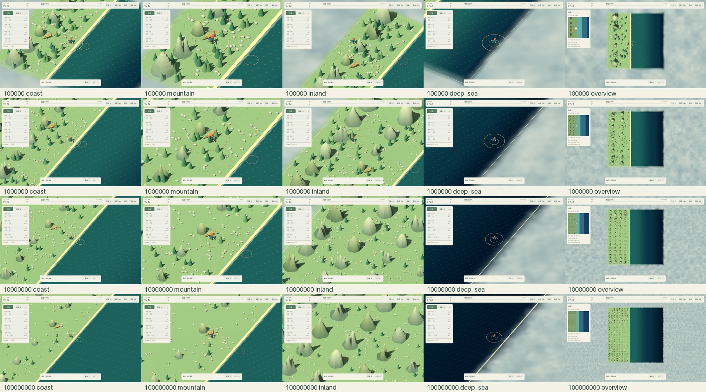

# ART-00：现状画面与运行基线

日期：2026-10-14（Asia/Shanghai）。游戏代码基于 ed68153，ART-00 只增加测量工具与文档，没有修改模型、玩法、正式存档格式或渲染配置。

## 已取得的证据

完成四档地图×五种镜头，共 20 张 1440×900 原始截图和对应短时运行记录。仓库保存 720×450 审阅图、拼图与紧凑 JSON；原始 PNG、逐帧样本和运行日志位于被忽略的 artifacts/art/art00-20261014-v1。可用下方工具重新生成。



拼图从上到下是 10 万、100 万、1000 万、1 亿石；从左到右是出生海岸、山脚、大陆深处、深海、全图。图中仍为当前程序模型，不是新美术方案效果图。

完整指标见 [20 场景数据表](reference/art00/metrics.md)，每个镜头的精确位置、旋转、缩放和样本数见 [结果摘要](reference/art00/results-summary.json)。JSON 中 screenshot 字段指原始 PNG 文件名；同名 JPG 为仓库中的缩小审阅版。

## 固定场景约定

所有场景为未填海、未升级、空背包、未解锁开山的初始状态。只改变观察位置与镜头；未载入玩家存档、未伪造资源收益。资产是实际主场景使用的 World 与 HUD。

| 档位 | 固定种子 | 网格 | 山数 | 跟随相机基础 size |
| --- | ---: | --- | ---: | ---: |
| 100000 | 10213 | 12×12 | 6 | 29.000 |
| 1000000 | 20261014 | 24×24 | 18 | 33.777 |
| 10000000 | 314159 | 48×48 | 60 | 39.341 |
| 100000000 | 271828 | 96×96 | 180 | 45.823 |

精确浮点值以结果 JSON 为准，表内只作近似展示。

| 镜头 ID | 定位方法 | 镜头与界面 |
| --- | --- | --- |
| coast | 玩家 XZ = (-2.5, 3.0) | 跟随，zoom=1，升级栏展开。 |
| mountain | 第一座山 NPC 位置加 (1.4, 1.4) | 跟随，zoom=0.72，检查精卫、NPC、山脚。 |
| inland | 找到最靠近 (大陆西边界×0.7, -地图边长×0.1) 的已有散石点 | 跟随，zoom=1；从资源点观察内部山群。 |
| deep_sea | 中间一行的倒数第二列中心；若不是深海则选最后一列 | 跟随，zoom=1，检查深水与外部迷雾。 |
| overview | 初始玩家位置，原有全图相机 | size=地图边长×1.6，显示全图侧栏。 |

地图尺寸不同会使相同镜头规则下的屏幕尺度不同，这正是本组对比要保留的现状。海浪和雾使用引擎 TIME，因此复现保证地图布局、镜头及角色 CPU 姿势一致，不保证 PNG 每个像素相同。

单独重跑 100000-coast，确认种子、玩家位置、相机位置、旋转、size、zoom 和截图尺寸均与 20 场景采集一致。该次数据保存在 [重复采样摘要](reference/art00/repeat-coast-summary.json)。另以 1152×720 实际窗口检查出生海岸，验证小窗口截图生成与 UI 布局。

## 设备与渲染条件

| 项目 | 本次记录 |
| --- | --- |
| CPU | Intel Core i9-13900HX，Godot 报告 32 个逻辑处理器。 |
| GPU | NVIDIA GeForce RTX 4060 Laptop GPU。 |
| 驱动 | 引擎启动日志报告 NVIDIA 581.57。 |
| 内存 | Godot 报告物理内存 16,978,403,328 字节，约 15.81 GiB。 |
| 系统 | Windows，系统 API 版本 10.0.22631。 |
| 引擎 | 随附 Godot 4.7.2-stable official；编辑器可执行文件运行项目。 |
| 渲染器 | Compatibility / OpenGL 3.3。 |
| 实际截图与窗口 | 主基线为 1440×900，20 张图均检查实际尺寸。 |
| 抗锯齿 | 引擎报告 MSAA 3D=0，屏幕空间 AA=0；现状未开启。 |
| 同步和帧率限制 | 本测量进程关闭 VSync，Engine.max_fps=0；不修改 project.godot。 |
| 光照 | 暖色方向光+环境光，方向光阴影开启，距离 90；具体参数见 style-guide.md。 |
| 音频/输入/存档 | 本工具静音、禁用真实输入和保存，以固定镜头运行。 |
| 测量负载 | 实际模型、世界和 HUD；60 Hz 空闲动画；0.15 秒同步 HUD/世界；0.2 秒推进模拟。 |

运行发生在当前桌面会话，窗口由自动化启动；不是独占机器或正式发布构建。CPU/GPU 功耗、其他程序负载、驱动缓存状态未隔离。不能拿这里的 FPS 比较不同电脑，也不能从空闲场景直接推算完整游玩性能。

## 测量方法与结果解释

每个场景重新生成世界，先预热 3 秒，再采集约 5 秒。逐帧间隔使用单调时钟记录，不使用固定帧率模式；平均 FPS 为帧数除以采样时间，p95 为排序后最接近上取整的 95% 分位。保存截图发生在计时结束后。20 个场景的逐帧数组已与摘要计数、平均值、p95 交叉校验。

绘制调用与静态内存由 Godot Performance 监视器读取。监视器更新可能有延迟；“引擎静态内存”不等于进程全部内存或显存；渲染 primitives 字段保留官方名称，不称为模型三角形数。帧时间包括当前桌面调度影响，不是单独的 GPU 执行时间。

| 代表场景 | 平均 FPS | p95 帧时间 | 最大单帧 |
| --- | ---: | ---: | ---: |
| 10 万石出生海岸 | 115.3 | 25.29 ms | 68.57 ms |
| 100 万石出生海岸 | 321.3 | 7.67 ms | 35.33 ms |
| 1000 万石出生海岸 | 190.3 | 15.78 ms | 47.45 ms |
| 1 亿石出生海岸 | 186.6 | 12.50 ms | 41.26 ms |
| 1 亿石全图 | 66.5 | 62.61 ms | 130.26 ms |

这里存在显著波动。相同的 10 万石出生海岸单独重跑得到约 742.0 FPS、p95 3.44 ms，与批次内结果不同；此次没有修改游戏资产或渲染代码。因此这些数据只能视为运行记录和后续调查起点，不能把差异归因于模型数量，也不能据最高帧率宣称已达标。ART-08 应在可控制的设备与电源条件下重复较长采样，覆盖移动、开采、投石和连续事件。

第一轮曾请求 1920×1080，但桌面实际限制得到 1688×1055 图像，且大陆镜头过近边界；该轮仅用于调试，没有并入主基线。正式参考重新按 1440×900 和本文镜头规则采集。1080p 是后续发布目标，当前没有据本组结果完成 1080p 性能验收。

## 画面审阅结论

| 观察 | 对应证据 | 后续处理包 |
| --- | --- | --- |
| 精卫现有赤冠、青羽和浅腹已提供颜色识别；头部和翅膀仍有拼接感。 | coast、mountain | ART-02 连贯造型与动作。 |
| 穿山甲覆甲细节在近景可见，但由独立尖锥构成；鳞片容易呈现颗粒状。 | mountain | ART-03 鳞甲分组、长尾与动作。 |
| 山体虽有五种轮廓，主要表面仍很平滑，部分圆丘有规则网格条纹感；树木与尖峰形状接近。 | mountain、inland | ART-04 岩层与断面，ART-05 树冠分组。 |
| 初始海岸接近直线，沙滩宽度固定；水面波纹重复较明显。 | coast、deep_sea | ART-05 局部岸线、湿边与水面。 |
| 大地图出生地更空旷，主角随相机拉远显得更小；全图山群具有明显的规则布局感。 | 1 亿石 coast、overview | ART-07 辨识度评审，ART-08 受约束的组合变化。 |
| 地图边缘的雾占据较多屏幕；小地图大陆镜头仍能看见边界，不能靠删除遮挡规则处理。 | 10 万石 inland、各档 deep_sea | ART-05 调整过渡与场景构图。 |
| HUD 保持单侧栏和顶部资源；本轮没有发现基线截图中的按钮越出窗口。 | 全部场景及 1152×720 实机检查 | ART-07 保留信息层级并继续检查。 |

本组全是初始地图，不能据此验收开采阶段、填海后的岸线、神器展示、动画衔接或碰撞正确性。这些内容由对应后续包补齐。

## 复现方法

在项目根目录打开 PowerShell，运行以下命令。工具先使用现有启动器准备引擎和导入资源，随后在真实图形窗口中测量，结果保存到独立目录；不要同时运行多个性能采集实例。

```powershell
powershell.exe -NoProfile -ExecutionPolicy Bypass -File tools/capture-art-baseline.ps1
```

默认生成 20 场景，约需三分钟，输出到 artifacts/art/baseline-run。可用 -GodotPath 指定其他引擎控制台程序，但正式对比应使用相同版本。

单场景与小窗口复查：

```powershell
powershell.exe -NoProfile -ExecutionPolicy Bypass -File tools/capture-art-baseline.ps1 -Target 100000 -View coast -OutputDirectory "artifacts/art/repeat coast"
powershell.exe -NoProfile -ExecutionPolicy Bypass -File tools/capture-art-baseline.ps1 -Target 100000 -View coast -Resolution 1152x720 -Seconds 2 -OutputDirectory "artifacts/art/small-window"
```

用于归档的主测量应保持默认 5 秒采样与 1440×900；更长压力测试另存目录并记录设置。辅助脚本 tests/art_baseline.gd 会拒绝无 --qa 或 headless 的启动，避免误读玩家存档或拿无图形结果作为渲染性能。

需要生成文档审阅图时，在已安装 Python 3 和 Pillow 的开发环境运行：

```powershell
python tools/summarize-art-baseline.py artifacts/art/baseline-run artifacts/art/review-output
```

该工具校验 20 场景、截图尺寸、样本计数和统计值，输出缩略图、拼图、表格及紧凑结果。Python/Pillow 只用于开发归档，玩家启动游戏不依赖它们。docs/art/.gdignore 阻止参考截图进入游戏资源导入。

## 范围与待验证事项

当前参考设备已明确，最低支持设备尚未确定；集显、省电模式、不同显卡驱动、长时间热稳定性和正式导出包性能均未验证。暂不据这些数据设置对玩家的最低硬件要求。

引擎日志仍有此前已知的 Windows 根证书库读取提示。本次图形采集与资源导入正常完成；只忽略这条已知诊断，其余脚本与引擎错误仍使复现工具失败。
