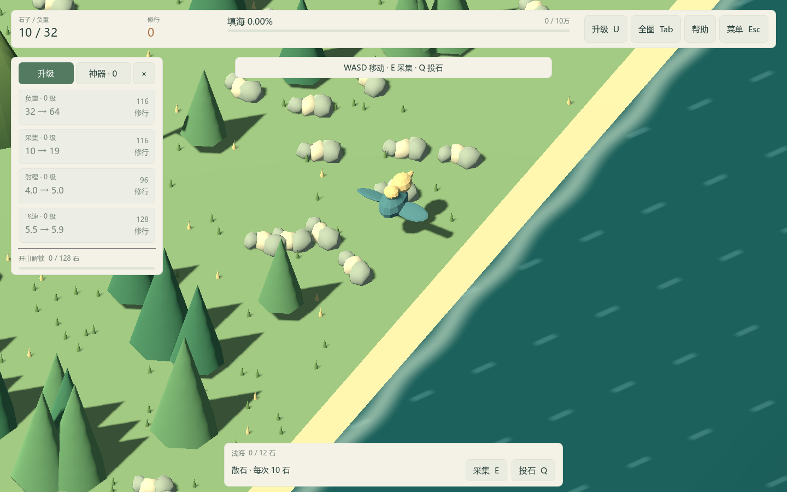
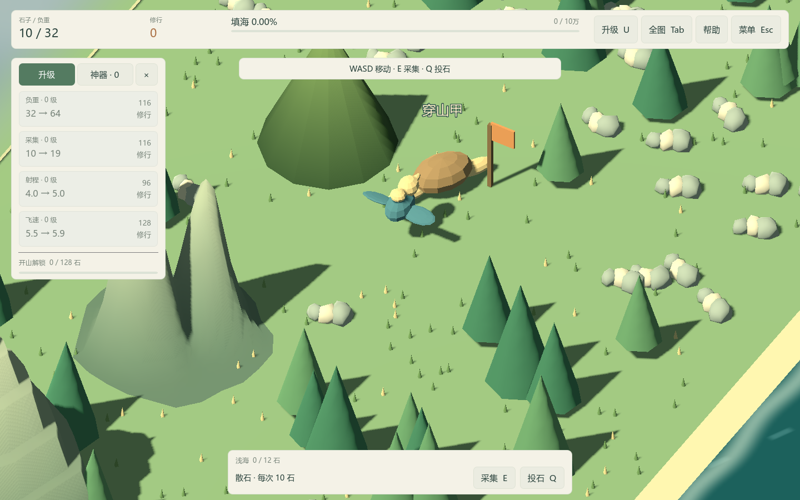
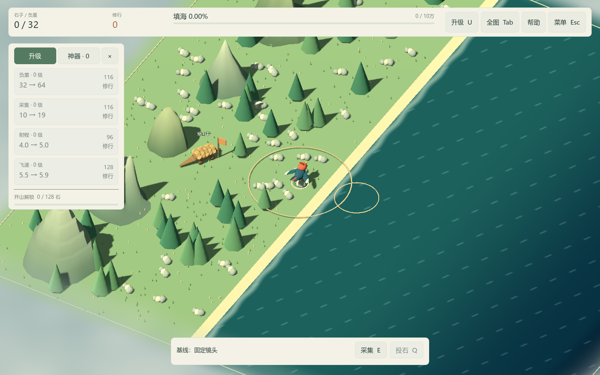

# ART-01 交付：资产导入与表现层接口

交付日期：2026-10-15。依赖 ART-00，状态：已完成。

## 实现与交付物

- [资产导入流程](../asset-pipeline.md)：米制、坐标朝向、原点、应用缩放、骨骼/动作名、目录、导出与导入步骤。
- [表现接口](../visual-contract.md)：精卫运动/高飞/负重/采集/投石，穿山甲目标/工作/完工，山体尺寸/开采/库存。
- `art_source/`：三个实际 Blender 源文件、占位生成器与单资产导出器，全部由 `.gdignore` 排除引擎导入。
- `assets/models/pipeline_examples/`：三个导出的 GLB 及导入设置；精卫和穿山甲包含真实蒙皮与命名动作。
- `scripts/visuals/` 与 `scenes/actors/`：程序模型适配、可替换 GLB 角色、手动动画时钟和山体快照。
- `scenes/art/pipeline_preview.tscn`：可选四档规模、可完整操作的导入模型示例，关闭存档。只替换第 0 类山，其他四类证明可以混用。
- `tests/test_visuals.gd`、原玩法测试的 `--imported-visuals` 模式、`tools/verify-clean-art-copy.ps1` 与实机截图脚本。

world/main 不再依赖 WingLeft、WingRight、Load 节点。尺寸常量和储量尺度由 state 提供，山体继续共用五组 MultiMesh。采集、投石和开山仍由逻辑先结算，动画只展示结果，存档版本仍为 3。

## 验证结果

| 验证 | 结果 |
| --- | --- |
| 原有状态、玩法、音效和 UI | 413 项全部通过。 |
| 表现层集成 | 41 项全部通过，包含实际骨骼姿态变化、可选负重附件、暂停、连投、完工、换图。 |
| 导入 GLB 后完整玩法回归 | 70 项全部通过，覆盖四档地图、资源循环、碰撞、射程、唯一工人、重开和存档。 |
| 无制作工具的新源码副本 | 从内附 ZIP 提取 Godot，首次导入与上述 524 项全部通过；无本地缓存或工具依赖。 |
| 实机 | Godot 4.7.2，Compatibility/OpenGL 3.3，RTX 4060 Laptop GPU，1440×900；三个画面均成功渲染。 |
| 分发文件 | 新 GLB 合计 151,680 字节，三个 `.blend` 合计 1,444,766 字节；不提交 bpy、备份、缓存、日志或提取后的引擎 EXE。 |

本地原始记录：`artifacts/art/clean-20261014-222027/artifacts/*tests.log`、`artifacts/art/art01/capture*.log`、`artifacts/art/art01-default/results.json`。文件夹时间沿用首次验证时的命名。唯一环境提示为 Windows 根证书库读取提示，未出现游戏脚本解析或运行错误。

复现：运行 Test.cmd；或使用 `tools/verify-clean-art-copy.ps1` 创建另一个新副本。示例在编辑器 F6 运行，详细命令见资产流程。

## 实机画面

导入占位精卫与携带附件：

导入穿山甲、标准化山体及原有山形混用：

默认入口保留当前程序外观，沿用 ART-00 固定种子与海岸镜头：

截图仅作为导入成功和默认外观回归证据。占位模型尚未达到正式美术质量；下一包 ART-02 制作精卫正式模型与动作，ART-03/04 分别制作穿山甲和样板山体。
