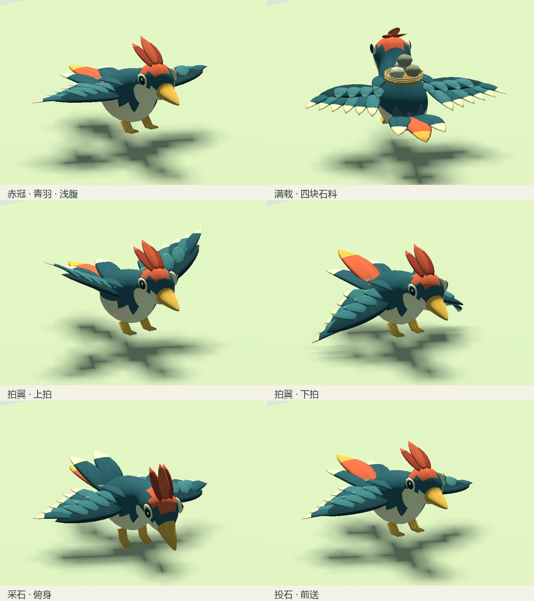
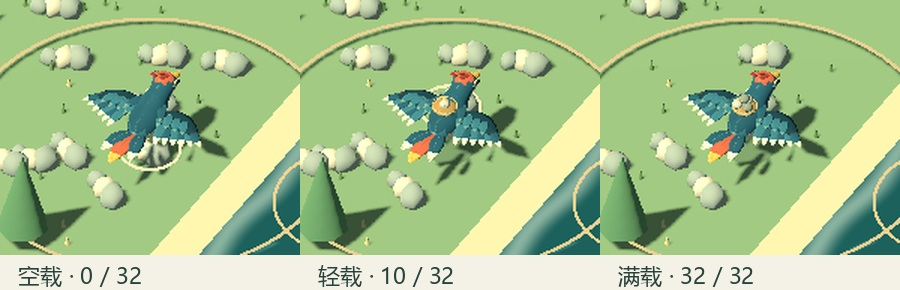
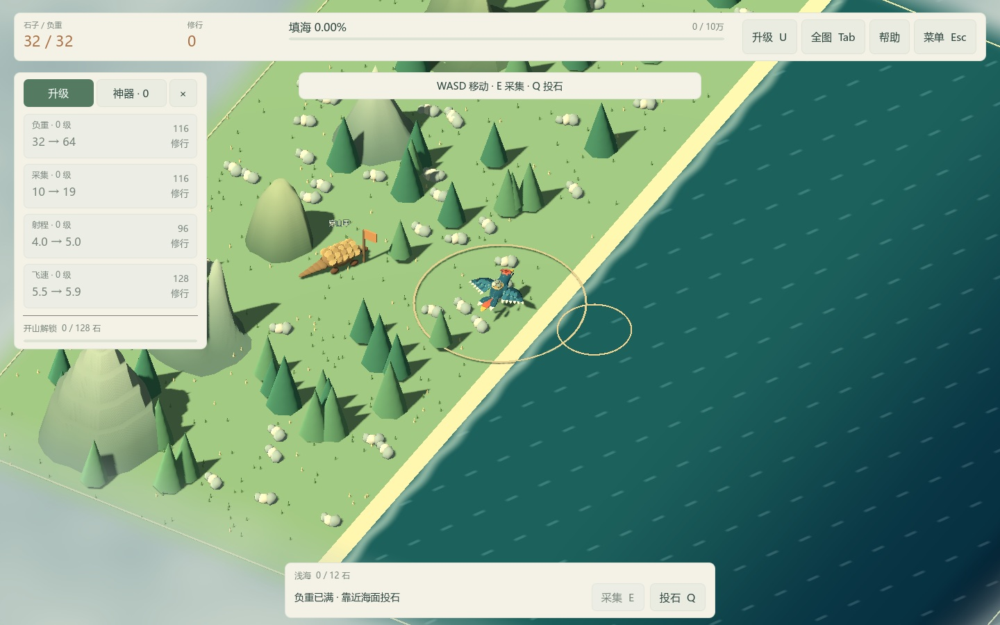

# ART-02 交付：精卫模型与动作

交付日期：2026-10-15。依赖 ART-01，状态：已完成。新精卫已接入普通 Play.cmd。

## 角色与文件

赤冠、青羽、浅腹、金喙；身体经颈部、头部直至喙尖为一张连续封闭网格。双翼分为翼面、覆羽和主飞羽，保留浅色羽尖；三簇尾羽以中央赤羽形成朝向线索。眼睛和冠羽为附属细节，跟随头骨；不是旧版球体头身的直接拼接。

| 交付物 | 路径/数据 |
| --- | --- |
| Blender 源文件 | `art_source/characters/jingwei.blend`，1,820,323 字节。 |
| 可复现生成与制作清单 | `art_source/build_jingwei.py`、`art_source/characters/jingwei-manifest.json`。 |
| 游戏模型 | `assets/models/characters/jingwei.glb`，1,070,952 字节，已保存源文件并重新打开后导出。 |
| UV 与材质 | 1024² 绘制图集 `assets/textures/characters/jingwei_atlas.png`，698,899 字节；共享 `assets/materials/jingwei_feather.tres`，粗糙度 0.86。 |
| 模型预算 | 精卫 6,912 三角形，轻载附件 648，满载附件 876；最大可见合计 7,788，1 个共享材质、最多 2 个可见表面。 |
| 骨骼与权重 | 12 根骨骼，包括头、脊柱、双侧翼/腕、足与三簇尾羽；导出归一化权重，每顶点不超过 4 个影响。 |
| 游戏角色场景 | `scenes/actors/jingwei.tscn`；默认 world 自动使用，四档地图共用。 |
| 独立预览 | `scenes/art/jingwei_preview.tscn`，编辑器 F6 运行；点击动作、空格切换负重、拖动旋转、滚轮缩放。无游戏状态或存档访问。 |

图集由项目生成器绘制大块明暗、羽轴和克制的羽纹，再按 UV 分配到模型；没有外部模型、贴图或参考截图。源文件保留 UV、蒙皮、NLA 动作及相对纹理路径。Godot 自动生成导入 LOD；本包没有手工 LOD。

## 动作与接入

| 类别 | 动作/行为 |
| --- | --- |
| 待机 | `idle`，缓慢拍翼和轻微呼吸起伏。 |
| 飞行 | `fly`，翼根和腕部错相拍动，尾羽小幅平衡。 |
| 转向 | `turn_left` / `turn_right`，两侧羽翼不对称，并叠加平滑侧倾；保持最短方向旋转。 |
| 采石 | `gather`，头颈俯下、躯干稍降、足爪前伸，持续 0.42 秒。 |
| 负重飞行 | `carry_fly`，较慢的拍翼节奏，维持石篓与肩背稳定。 |
| 投石 | `throw`，头身前送与拍翼配合，控制器将导入片长缩放至原有 0.48 秒投射时序。 |

循环动作使用 0.09 秒交叉混合。采集/投石收到成功结算事件才播放，连按可重新开始；结束后恢复最新运动状态。动画随现有模拟时钟推进，暂停、对话和规模选择时停止；换地图销毁旧模型。碰撞球半径 0.32、低飞高度 1.45、射程、石料和存档版本均沿用原规则。

空载隐藏石篓；负重占比 (0, 65%] 显示轻载一块石料，超过 65% 显示满载四块石料。两套石篓随 Spine 蒙皮，最多同时显示一套；升级后的大数量仍只使用固定网格。

## 验证与画面

- 原有状态、默认游戏、音效、UI、占位导入表现及占位游戏回归共 524 项通过；新增精卫专项 39 项通过，总计 **563 项，0 失败**。
- 专项检查实际采样骨骼，确认左右拍翼高度对称且具有明显上下行程；覆盖最短转向、侧倾恢复、三档负重、动作截止时间、暂停、连投、模型替换和换地图清理。
- 生成器实际检查头身喙网格只有一个连通部分、所有边封闭。角色 UV、归一化权重、纹理大小和最大可见三角形预算也已验证。
- `tools/verify-clean-art-copy.ps1` 创建 `artifacts/art/clean-20261015-104725/`，无旧缓存、已提取引擎 EXE 或建模工具，限制 PATH 后从仓库内 ZIP 准备 Godot，完成首次导入和全部 563 项检查。
- 真实 Godot 4.7.2 Compatibility / OpenGL 3.3，RTX 4060 Laptop GPU，在 1440×900 和 1152×720 分别渲染 14 个固定姿势与游戏画面。正常镜头可识别冠羽、朝向及负重；一亿石地图最远正常缩放下仍有主角色块与轮廓，全图继续由位置标记承接识别。

以下是引擎实际渲染的姿势摘选，不是建模软件渲染：

游戏镜头中的三档负重局部放大：

1440×900 正常跟随镜头：

1152×720 独立窗口实测：

最大地图、最远正常缩放：[实机截图](../validation/art02/large-map-far.jpg)。该缩放用于远距离观察，细节主要在跟随镜头和近景检查；没有为此改变摄像机、资源规则或 UI。

原始 PNG 和渲染日志在 `artifacts/art/art02/` 与 `artifacts/art/art02-small/`，干净副本测试日志在其 `artifacts/*tests.log`。最终运行日志仅有本环境的根证书库读取提示，没有游戏脚本错误。截图和测试不访问玩家旅程。

复现模型：`blender --background --python art_source/build_jingwei.py`；手工编辑后用 ART-01 的单资产导出器。复现检查：Test.cmd。复现画面：Godot `--path . --resolution 1440x900 --script res://tests/capture_jingwei.gd -- --qa`；小窗口改为 1152x720 并追加 `--review-out=res://artifacts/art/art02-small`。

本包完成精卫资产和玩法接入；穿山甲、环境光照及整体上线视觉验收继续由 ART-03、05、07 处理。本轮不据短时画面记录承诺最低配置或发布性能。下一包：ART-03 穿山甲模型与动作。
