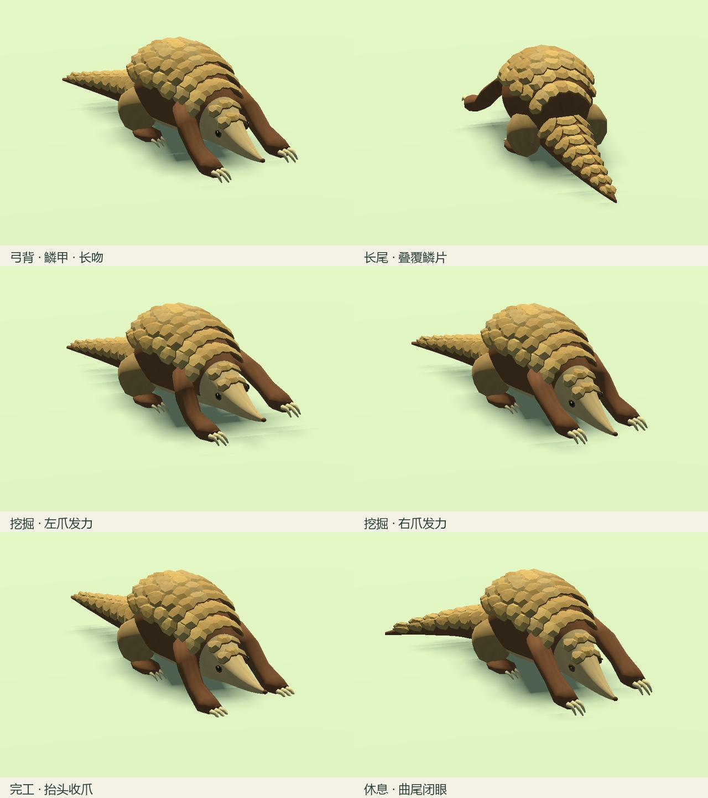
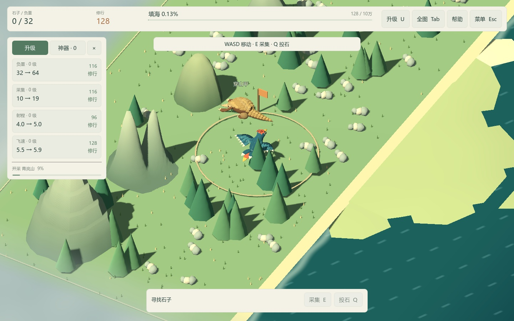
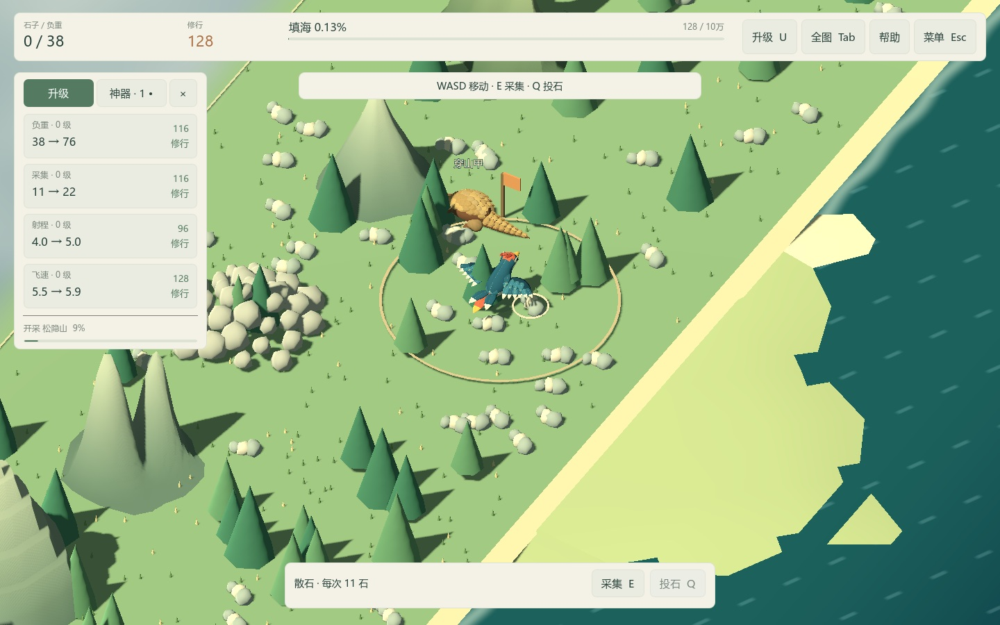

# ART-03 交付：穿山甲模型与动作

交付日期：2026-10-15。依赖 ART-01，状态：已完成。新穿山甲已接入普通 Play.cmd。

## 造型与文件

长吻与弓背为连续封闭网格，配合贴身叠覆的片状鳞甲、逐渐变细的长尾、宽前掌和三支主要掘爪。鳞片采用浅中央脊与斜边，按背部、头部和尾部成组排列，替换原先独立锥形尖刺；所有细节并入一张蒙皮网格。

| 交付物 | 路径与数据 |
| --- | --- |
| 可编辑源模型 | `art_source/characters/pangolin.blend`，3,283,515 字节。 |
| 生成器与清单 | `art_source/build_pangolin.py`、`art_source/mesh_tools.py`、`art_source/characters/pangolin-manifest.json`。 |
| 游戏模型 | `assets/models/characters/pangolin.glb`，1,321,788 字节。 |
| UV 图集与材质 | `assets/textures/characters/pangolin_atlas.png`，1024²、634,352 字节；`assets/materials/pangolin_keratin.tres`，粗糙度 0.88。 |
| 几何预算 | LOD0 为 8,040 三角形，1 个共享材质、1 个蒙皮表面；Godot 自动生成导入 LOD。 |
| 骨骼与权重 | 18 根骨骼；每顶点不超过 4 个归一化权重。头身、下颌、眼部、肢爪与三段长尾分别控制。 |
| 鳞片 | 背部 56、头部 6、尾部 24，共 86 片。 |
| 默认角色场景 | `scenes/actors/pangolin.tscn`；四档地图共用同一资产。 |
| 独立预览 | `scenes/art/pangolin_preview.tscn`，编辑器 F6 运行；点击动作，拖动旋转，滚轮缩放。无模拟、资源和存档访问。 |

网格、角质纹理绘制和动作均为项目原创生成，没有外部美术文件。源文件保留 UV、蒙皮、命名 NLA 动作和相对贴图路径，实际保存并重新打开后导出 GLB。玩家运行不依赖 Blender 或 Python。

## 工作状态与动作

| 状态 | 动作与接入 |
| --- | --- |
| 待机 | `idle`，轻微呼吸、尾部摆动和眨眼；供静止预览及无工作状态使用。 |
| 未解锁 | `locked`，抬头观察并侧看；累计填海不足 128 石时使用。 |
| 移动 | `walk`，前后肢交替步态；换山时使用 0.35 秒原地入场步。 |
| 挖掘 | `dig`，左右前爪交替抬起、回刨，躯干小幅发力，三段长尾配合平衡。 |
| 完工 | `complete`，抬头、收爪和尾部小幅摆动，持续 0.70 秒。 |
| 全部挖完 | `finished`，闭眼、降低头部并将长尾弯向一侧，持续休息。 |

根节点立即跟随逻辑目标的 npc_position，正面朝向该山。角色不沿两山间的真实路径行走，入场步只表现切换；逻辑开采不停顿，对话点和地图标记不跟随动画偏移。完工动作与随后入场步分段计时，再回到新目标挖掘；循环动作采用 0.10 秒混合。

世界只复用同一只穿山甲。读档直接恢复目标、解锁状态和开采比例，不补播历史完工/入场；暂停、对话和规模选择时动作与入场计时停止。开山门槛、顺序、生产速度、有限库存、神器及存档版本 3 沿用原规则。

## 验证

- 新增穿山甲专项 **55 项**，实际采样骨骼验证前爪交替、尾部运动、步态、休息曲尾、朝向、暂停、完工与入场顺序；原有 563 项全部通过，合计 **618 项，0 失败**。
- 专项覆盖四档地图的唯一工人、真实填海 128 石解锁、模型与对话点重合、动画重放不改变资源；验证实际换山复用节点、全部完工休息、重开销毁旧动作。
- 使用真实 version=2 存档夹具验证迁移后显示正确工作目标和未完工比例，不重复生成资源或播放历史事件。
- 生成器检查头身长吻只有一个连通部分且封闭。引擎检查 UV、归一化权重、1024² 贴图和三角形预算。挖掘一周期采样中，吻尖最大前伸 1.470，低于站位与山脚间 1.5 的间隔；爪尖允许浅入地面，最低 −0.085，仅用于刨挖视觉。
- `tools/verify-clean-art-copy.ps1` 在 `artifacts/art/clean-20261015-131607/` 创建无缓存、无已提取引擎 EXE、无制作工具的新副本，限制 PATH 后由内附 ZIP 准备引擎，首次导入并通过全部 618 项。
- 真实 Godot 4.7.2 Compatibility / OpenGL 3.3，RTX 4060 Laptop GPU，在 1440×900 与 1152×720 各渲染 14 张角色姿势和游戏画面，检查未解锁、挖掘、换山、普通跟随镜头、全部完工和最大地图。

原始 PNG 与日志：`artifacts/art/art03/`、`artifacts/art/art03-small/`；测试日志在上述干净副本的 `artifacts/*tests.log`。最终运行仅出现本环境的根证书库读取提示，无游戏脚本错误。

## 实机画面

角色与动作摘选：

面向工作山体、前爪挖掘：

换山后仍是同一角色，旧山留下有限石料：

全部山挖完后休息：[实机画面](../validation/art03/game-finished.jpg)。普通跟随缩放：[实机画面](../validation/art03/game-normal.jpg)。1152×720 独立窗口：[实机画面](../validation/art03/game-1152.jpg)。

画面中仍有原程序环境，个别树木会遮挡角色局部；环境布局和整体遮挡评审继续由 ART-05/07 处理。本包交付穿山甲模型与工作状态，不以短时画面记录承诺最终发布性能。

## 复现与下一包

- 重建模型：`blender --background --python art_source/build_pangolin.py`；会覆盖穿山甲生成资产。手工修改后使用 ART-01 单资产导出器。
- 检查：Test.cmd；无缓存分发检查使用 `tools/verify-clean-art-copy.ps1`。
- 实机截图：Godot `--path . --resolution 1440x900 --script res://tests/capture_pangolin_art.gd -- --qa`。小窗口改为 1152x720，并追加 `--review-out=res://artifacts/art/art03-small`。

下一包为 ART-04：样板山体与开采变化。
