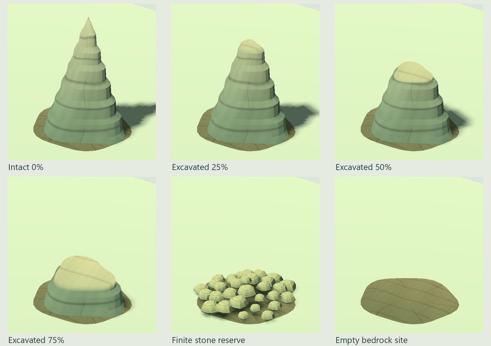
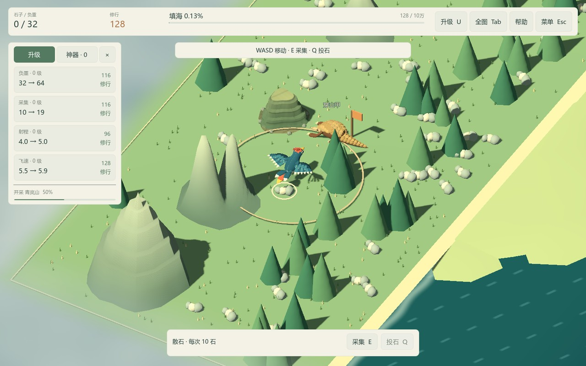
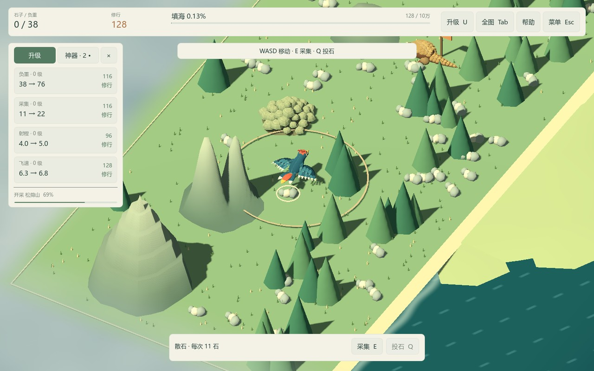

# ART-04 交付：样板山体与开采变化

交付日期：2026-10-15。依赖 ART-01，状态：已完成。普通 Play.cmd 已使用第 0 类岩层样板山，包括第一座青岚山；其他四类保留程序轮廓，扩展由 ART-08 完成。

## 资产与制作

样板采用偏移主峰、三组宽支脊、岩层台阶和明确山脚；共享岩层图绘制水平沉积带及少量裂缝。开采从顶部向下压低为闭合断面，断面使用浅暖裸岩色，侧面保留岩层。完整、约 25%、50%、75%、完工石料、搬空山址六种状态有固定入口，并可连续预览中间比例。

| 交付物 | 路径与实测 |
| --- | --- |
| 可编辑源资产 | `art_source/environment/strata_mountain.blend`、`quarry_stone.blend`、`quarry_site.blend`，合计约 1.27 MiB。 |
| 生成器/清单 | `art_source/build_mountain.py`、`art_source/environment/mountain-manifest.json`。 |
| 岩层山 | `assets/models/environment/strata_mountain.glb`，1,918 三角形，504,336 字节。 |
| 石料 | `quarry_stone.glb`，68 三角形，404,400 字节；满库存 32 个实例，共 2,176 三角形。 |
| 山址 | `quarry_site.glb`，252 三角形，415,320 字节；浅裸岩、径向裂纹和工具刨痕。 |
| 共享岩层图 | `assets/textures/environment/strata_paint.png`，1024²、398,440 字节；启用线性 mipmaps。 |
| 材质 | `assets/materials/strata_mountain.tres`、`quarry_stone.tres`、`quarry_site.tres`，共享上述纹理。每资产一个网格、一个材质表面。 |
| 预览 | `scenes/art/mountain_preview.tscn`，编辑器 F6；六阶段按钮、开采/库存滑杆、拖动旋转、滚轮缩放。 |

网格与纹理均为本项目原创，没有外部美术资产。生成器检查封闭流形，保存后重新打开源文件再导出 GLB。三个 GLB 采用内嵌纹理模式 3；运行材质复用外部共享图，不额外提取同名 PNG。Godot 生成导入 LOD，本包未制作手工远景 LOD；玩家运行不需要 Blender/Python。

## 阶段、尺寸与碰撞

- 尺度继续使用 `min(1.7 × (储量 / 1024)^0.18, 地块短边 × 0.39)` 的山脚半径，高度为半径 × 2.25；没有改变生成储量、地块、采集范围或 NPC 站位。相同模型的体量随储量增长，直至触及通道约束。
- `MountainVisual.from_state` 返回只读数值快照，增加 progress 与 settled。连续比例直接驱动削顶，取消旧的 1/32 刷新门槛，接近完工时也不会保留过高碰撞。
- 样板使用八层低成本圆柱包络，半径从共享网格各高度段取得；顶部层随断面缩短，已移除的层禁用。所有碰撞的实际总高等于原山高 × 剩余比例。其他原型山仍是单圆柱。包络有保守余量，不是逐三角形碰撞。
- 原高飞上限不随开采降低，继续足以越过所有山体；先前的实际高度增程规则保持有效。Compatibility 自定义颜色读回的半精度误差按 0.0005 归一化绝对误差检查，碰撞使用完整逻辑比例。
- 开采中的八块装饰碎屑与全世界最多八团复用扬尘没有资源和刚体。整山完工后，规则层才生成一次完整库存；世界随后隐藏山体和全部碰撞、显示有限石场。
- 石场散布半径为 min(2.5, 山半径 × 0.82)，随剩余比例降低堆高并减少可见组数。库存为零时所有资源石块消失，保留最高为原山高 2.4% 的山址；遗迹不具有采集、碰撞或再次开采能力。
- 装饰树距山脚预留 2.7、草预留 0.2 单位，避免削顶或搬空后露出穿山植被；采样次数有上限，无合适位置则隐藏该装饰。这是布局修正，未重做植被模型。

主场景没有新增常驻标签或面板。预览只操作临时数值，不访问玩家存档。暂停冻结扬尘和工作动作，换图销毁旧表现；读档从已有比例和库存直接恢复，不播放历史结算事件。保存格式仍为 version=3。

## 验证与实机记录

- Test.cmd 当前 **741 项检查全部通过**：原有 657 项加山体专项 84 项。专项覆盖四档地图的样板接入与有限实例数，连续比例、六阶段、实际物理射线、削顶上方通道、未完工不可采、全额库存只结算一次、搬空不可再产、存档恢复、真实旧档迁移、暂停与换图。
- 实际 Compatibility 渲染器运行山体专项 **113 项，0 失败**。其中包含相同的 84 项及额外 29 项 MultiMesh 比例、石堆显隐、山址位置和装饰避让读回。无窗口 dummy 渲染器不能可靠读回 MultiMesh 实例数据，因此这些 29 项明确留给实机执行，没有用默认空值当作画面验证。
- `tools/verify-clean-art-copy.ps1` 在 `artifacts/art/clean-20261015-150951/` 创建无缓存、无已提取引擎 EXE、无 `.tools` 的新源码副本。限制 PATH 后由内附 ZIP 准备 Godot，首次导入并通过全部 741 项；没有要求安装 Blender。
- Godot 4.7.2 Compatibility / OpenGL 3.3，RTX 4060 Laptop GPU，1440×900 与 1152×720 各渲染 18 张截图：六阶段、半库存、最后少量库存、背面、普通玩法、最大地图和全图。核对断面、石堆与遗迹衔接、中文界面、树草避让与原有高度射程显示。

原始截图：`artifacts/art/art04/`、`artifacts/art/art04-small/`。日志：`artifacts/art04-regression.log`、`artifacts/art04-visual-tests.log`、`artifacts/art04-clean-copy-final.log`；最终只出现本环境的根证书库读取提示，无游戏脚本或材质编译错误。测试与截图使用隔离存档，原始产物按忽略规则排除。

## 实机画面

六阶段使用同一资产、同一镜头：

实际游戏开采至 50%，穿山甲仍为唯一工人：

第一座山完工留下有限石料，工人继续下一座：

搬空后没有资源石块，山址保留：[空山址](../validation/art04/game-empty.jpg)。另见 [1152×720 独立窗口](../validation/art04/game-1152.jpg)、[普通跟随缩放](../validation/art04/game-normal.jpg)、[一亿石地图](../validation/art04/game-large.jpg)、[全图](../validation/art04/game-overview.jpg)。截图中的大背包仅为快速搬空的隔离验证进度，不是新增数值规则。

本包完成一套山体及完整生命周期。其余山型、树木资产、海岸、灯光与最终事件反馈尚未升级，整体观感在 ART-07 可玩样板中评审。本次没有用短时截图承诺发布帧率或最低配置。

## 复现与下一包

1. 重建资产：`blender --background --python art_source/build_mountain.py`；会覆盖本包三个源文件、GLB 和共享图。手工修改后使用 ART-01 单资产导出器。
2. 默认验证：Test.cmd。实际图形验证：Godot `--path . --resolution 1152x720 --script res://tests/test_mountain.gd -- --qa`。
3. 截图：Godot `--path . --resolution 1440x900 --script res://tests/capture_mountain_art.gd -- --qa`；小窗口改为 1152x720，追加 `--review-out=res://artifacts/art/art04-small`。
4. 干净副本：`tools/verify-clean-art-copy.ps1`。预览：打开 `scenes/art/mountain_preview.tscn`，按 F6。

下一包为 **ART-05：样板海岸、水面与灯光**。
