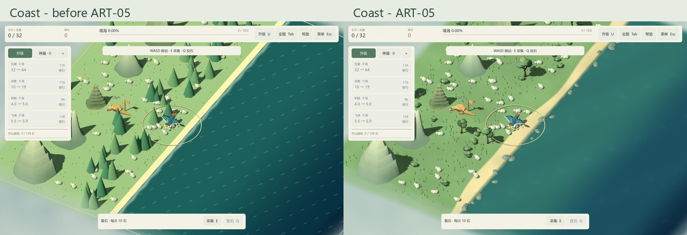
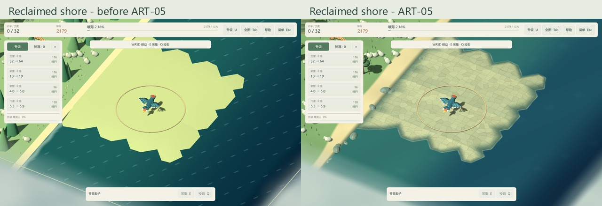
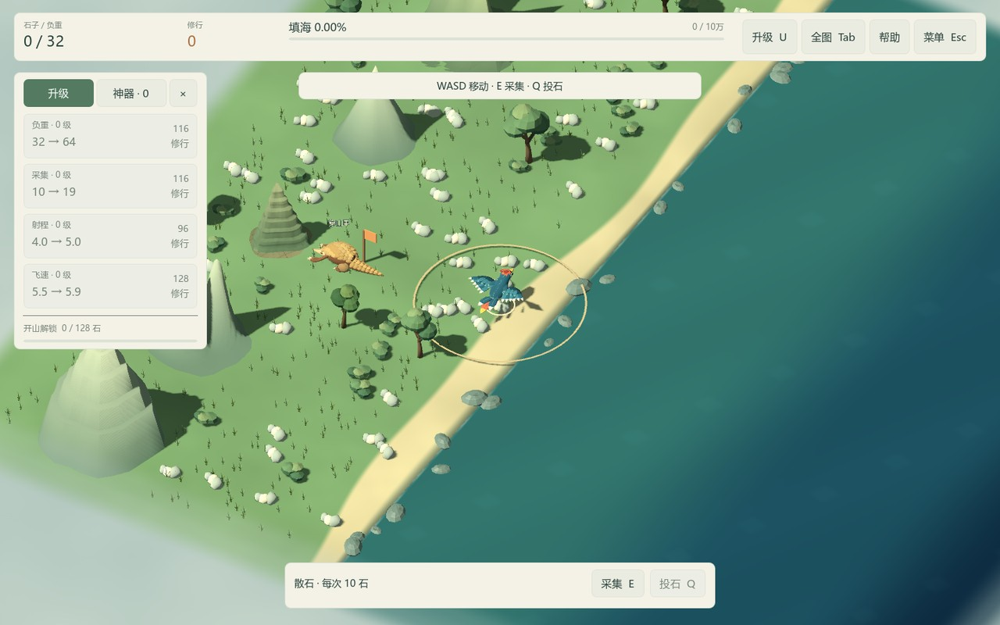

# ART-05 交付：样板海岸、水面与灯光

交付日期：2026-10-15。依赖 ART-01，状态：已完成。普通 Play.cmd 已使用新海岸、植被、海水和灯光；世界仍为西侧连续大陆、东侧海域，方形活动范围与四档海格需求保持原规则。

## 交付物

| 内容 | 文件与实测 |
| --- | --- |
| 原创源资产 | `art_source/build_coast.py`、`art_source/environment/coast-manifest.json`，以及 coast_tree/coast_shrub/coast_grass/shore_rock 四个 `.blend`，合计约 1.60 MiB。 |
| 树木样板 | `assets/models/environment/coast_tree.glb`，596 三角形、161,796 字节；弯曲分叉树干、五簇错落树冠。 |
| 灌木样板 | `coast_shrub.glb`，196 三角形、139,612 字节，三簇低矮叶团。 |
| 草丛样板 | `coast_grass.glb`，24 三角形、129,016 字节，六片不透明草叶，运行材质双面。 |
| 岸石样板 | `shore_rock.glb`，96 三角形、133,680 字节，低矮深灰湿石，不具备采集能力。 |
| 共享调色图 | `assets/textures/environment/coast_palette.png`，512²、125,819 字节；所有环境 GLB 为单网格/单材质，无骨骼、无内置碰撞。 |
| 地表与材质 | `coast_ground.tres`、`coast_foliage.tres`、`shore_rock.tres`、`reclaimed_ground.tres`、`shore_foam.tres` 及对应 shaders；复用本包图集和 ART-04 岩层图。 |
| 几何与水雾 | `scripts/visuals/coast_geometry.gd`、`scripts/world.gd`、`shaders/water.gdshader`、`shaders/boundary_fog.gdshader`。 |
| 可玩预览 | `scenes/art/coast_preview.tscn`；编辑器 F6，固定十万石海岸，正常 WASD/E/Q/鼠标/空格操作，禁用玩家存档访问。 |

网格、图集与程序表面均为本项目原创，无第三方美术素材。源文件保存后实际重新打开并导出 GLB，游戏不直接导入 `.blend`。GLB 内嵌纹理模式为 3，运行材质共享外部图，启用线性 mipmaps；不要求玩家安装 Blender 或 Python。Godot 自动生成导入 LOD，本包未交付全部植被变体、手工 LOD 或完整空间分批优化。

## 海岸与填海变化

沙滩宽度按 z 平缓变化，草地、干沙、湿岸依次过渡。所有沙滩网格限制在 x=-3～0 的陆地条带中，原始海陆逻辑分界仍为 x=0；大陆向西、南北继续延伸。海岸端点高度为 0.22，水面为 0.16，并以短垂直湿岸接合；没有把海域覆盖成可误认的大片陆地。第一海列的接岸角点与海岸共用同一位置，未填海床在海面附近的过渡偏移仅约 0.1 单位。

新陆地保持原海床中心高度算法，改用不规则碎石表面、按高度变化的湿润色与粗糙度。相邻区块共用世界坐标、角点高度和法线；法线采样比高度多一圈，因此投放后刷新周围两格涉及的区块，修复跨区块明暗接缝。没有改变海格类型、容量、投放结算或完成条件。

接水泡沫来自地形三角形与 y=0.16 水面的实际交线，随填海和邻格更新而重建。两个陆地区域连起来后，旧内部接水线自动清空；海岸原有泡沫带由新增地形的深度测试遮住。泡沫保持有限宽度与低透明度，不依赖屏幕深度重建、体积水或逐石物理。

海水采用平缓的浅海—远海—深海色彩过渡，波纹与高光强度降低。水面高度不波动，避免与湿岸/泡沫互相闪烁；最远视角淡出高频波纹和碎石细节，减少全图摩尔纹。迷雾仍为三层低成本平面，统一环境配色，噪声扰动主要留在范围外，内部仅靠边约 0.12 单位过渡；边界外依旧禁止移动和投石。

## 布局、灯光与暂停

- 树木、灌木、草丛、岸石均采用共享 MultiMesh，上限分别为 200、160、2,500、160，与石子数量无关。树根之间至少 2.8 单位，树木降低密度，资源点及穿山甲所有未来工作位预留通道。无法在有限次数中找到合适位置的装饰隐藏，不挤占山址或矿场。
- 低矮岸石比可采散石更暗，没有拾取指示、碰撞或资源。灌木和草在全图隐藏，返回正常镜头时复用原实例恢复。
- 仍为一盏方向主光：(-50°, -33°, 0°)、#FFF4DF、能量 0.68；环境光 #BDCFC4、能量 0.42，方向阴影距离 90，启用 2× MSAA。保持精卫、穿山甲、浅色可采石料与金圈的对比。
- 水、泡沫、植被与雾共用世界模拟时钟；暂停停止，恢复不会补播旧时间，换图释放旧网格及材质时钟。各世界的动态材质独立，图集与静态网格继续共享。

主界面未新增常驻标语、标签或面板。采集、开山、神器、飞行高度增程和保存规则沿用现有行为，存档仍为 version=3；真实旧档可恢复已有海床和填海岸线。

## 验证与运行记录

- 默认 Test.cmd 共 **812 项，0 失败**，含新增环境专项 71 项。专项覆盖四档地图、源模型预算与 UV、海陆边界、宽窄沙滩、真实接水线、跨区块共享顶点/法线、两格外刷新依赖、填满后的内部泡沫清理、资源守恒、存档恢复、暂停、换图和 F6 不保存样板。
- 实际 Compatibility 渲染器的环境专项 **95 项，0 失败**，包含上述 71 项与额外 24 项装饰位置、山址/采集点/工作位避让和根部接地读回。原有山体实机专项 **113 项**也重新通过。无窗口 dummy 不把 MultiMesh 默认空值当成真实画面结果。
- `tools/verify-clean-art-copy.ps1` 在 `artifacts/art/clean-20261015-160153/` 创建无缓存、无制作工具、无已提取引擎 EXE 的源码副本；限制 PATH 后由内附 ZIP 准备 Godot，首次导入并通过全部 **812 项**，不需要 Blender。
- Godot 4.7.2 Compatibility / OpenGL 3.3、RTX 4060 Laptop GPU，1440×900 与 1152×720 各保存 12 张实机图。另在改动前保存同种子、同位置、同缩放的 12 张对照图，包含普通/近景海岸、山脚、三层海水、相邻填海、区块交界、雾角和最大地图。
- 最大一亿石地图，种子 271828，1440×900、2× MSAA、关闭垂直同步，五个固定空闲镜头各预热 3 秒、采样 3 秒。CPU 帧间隔 p95 为海岸 1.56 ms、山脚 1.79 ms、大陆 1.45 ms、深海 0.95 ms、全图 1.71 ms。该记录只表示此设备的短时空闲负载，不是 GPU 时间、完整玩法压力、最低配置或发布帧率验收；没有据此宣称美术更新提升性能。含设备/设置的[汇总数据](../reference/art05/performance-summary.json)，逐帧原始数组保留在 artifacts。

最终日志仅出现本环境的根证书库读取提示，无游戏脚本或材质编译错误。截图和测试使用隔离存档；原始产物、缓存、源文件备份和本地制作运行库按忽略规则排除。

## 同镜头画面

海岸前后对比，逻辑地图与镜头保持一致：

相邻填海后的石质表面与湿润接水边缘：

正常镜头能看到树冠分组、浅色资源与穿山甲：

另见 [近景](../validation/art05/coast-close.jpg)、[工作位](../validation/art05/mountain.jpg)、[1152×720](../validation/art05/coast-1152.jpg)、[区块交界](../validation/art05/chunk-seam.jpg)、[雾角](../validation/art05/fog-corner.jpg)、[一亿石海岸](../validation/art05/large-coast.jpg)、[一亿石全图](../validation/art05/large-overview.jpg)。三层海水：[浅海](../validation/art05/shallow.jpg)、[远海](../validation/art05/far.jpg)、[深海](../validation/art05/deep.jpg)。

本包提供一套可玩环境样板；其余山型、更多植被组合、重要事件效果和神器尚待后续任务。整体遮挡、完整循环、审美与长时间性能结论继续由 ART-07～09 评审。

## 复现与下一包

1. 重建模型：`blender --background --python art_source/build_coast.py`；只覆盖本包四个源文件、GLB 和图集。手工修改后用 ART-01 单资产导出器。
2. 玩法与逻辑检查：Test.cmd；图形检查：Godot `--path . --resolution 1152x720 --script res://tests/test_environment.gd -- --qa`。
3. 截图：Godot `--path . --resolution 1440x900 --script res://tests/capture_environment_art.gd -- --qa`；小窗口改为 1152x720，并追加 `--review-out=res://artifacts/art/art05-small`。
4. 短时空闲记录：`tests/art_baseline.gd -- --qa --baseline-target=100000000 --baseline-out=res://artifacts/art/art05-benchmark-final --baseline-seconds=3`，使用真实渲染器。新下载验证：`tools/verify-clean-art-copy.ps1`。
5. 可玩样板：打开 `scenes/art/coast_preview.tscn`，按 F6；该入口不访问玩家存档。

下一包为 **ART-06：采集投石反馈与神器**。
