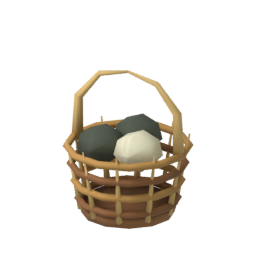
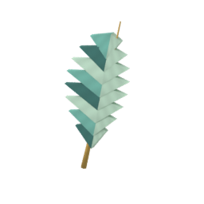
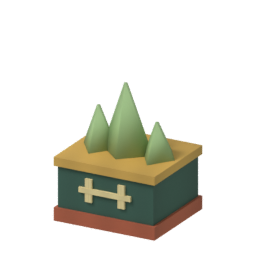
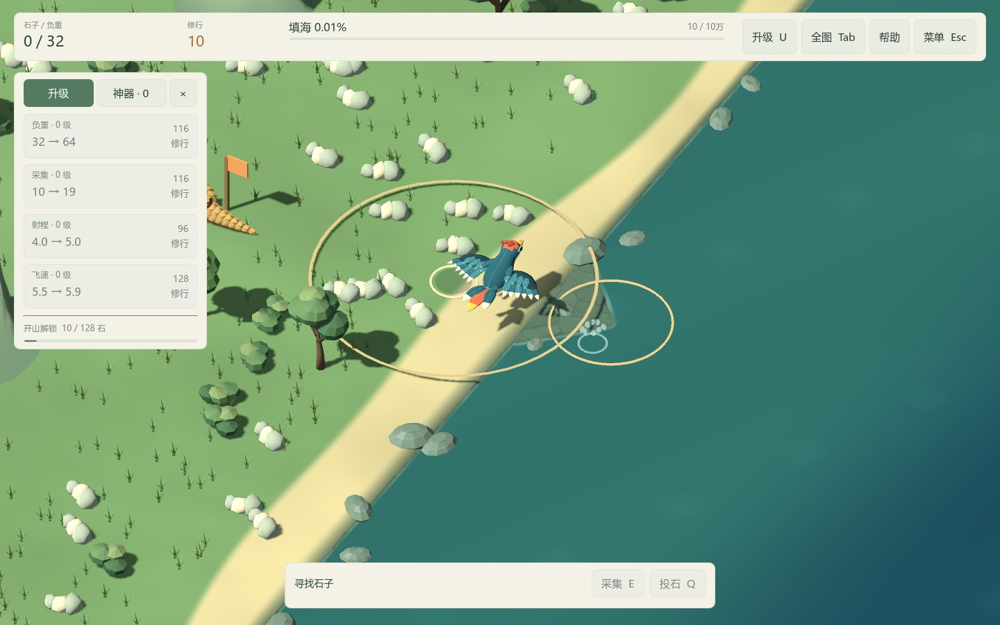
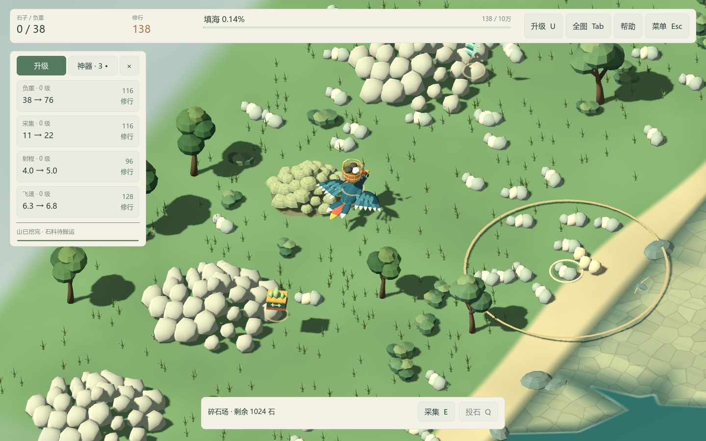
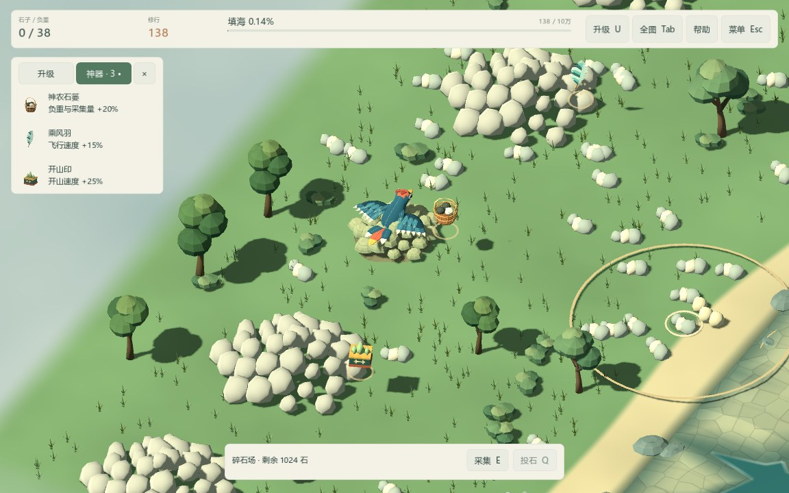

# ART-06 交付：采集投石反馈与神器

交付日期：2026-10-15。依赖 ART-02～05，状态：已完成。普通 Play.cmd 已使用本包反馈和神器资产。存档仍为 version=3，神器数值、出土阈值、开山与填海结算继续由状态层管理。

## 资产与制作

| 神器 | 模型 | 三角形 | 轮廓与配色 |
| --- | --- | --- | --- |
| 神农石篓 | `assets/models/relics/basket.glb`，51,960 字节 | 872 | 暖褐编织环、提梁、三块石头；保留开口。 |
| 乘风羽 | `assets/models/relics/feather.glb`，42,512 字节 | 172 | 不对称青白羽片、金色羽轴，羽片具有厚度。 |
| 开山印 | `assets/models/relics/seal.glb`，37,900 字节 | 108 | 方形玉印、三峰山钮、金边与朱砂底。 |

三件均为单网格、单材质，无骨骼与碰撞，模型尺度已应用。`art_source/relics/` 保存三个可编辑 `.blend` 和 `relic-manifest.json`；生成器为 `art_source/build_relics.py`，每个源文件保存后重新打开再导出。256² 调色图在 `assets/textures/relics/relic_palette.png`；GLB 内嵌纹理模式 3，不抽取重复 PNG。运行只使用 GLB 和图标，不依赖 Blender/Python。

三个 256² RGBA 图标在 `assets/icons/relics/`，由相同源网格、UV 和调色图从固定正交镜头渲染，透明背景。界面在现有神器页签加入 44×48 图标，未发现时降低颜色与透明度；名称、属性和未发现山名延续现有信息。

| 石篓 | 风羽 | 山印 |
| --- | --- | --- |
|  |  |  |

所有模型、纹理、图标与程序效果为本项目原创，没有引入第三方美术素材。效果使用共享飞石网格、环网格、按槽复用材质及 MultiMesh，不使用体积粒子或逐石刚体。

## 真实事件对应表

| 结算事件 | 可见反馈 | 时序与音效 |
| --- | --- | --- |
| 实际拾取量 >0 | 采集点暖色小环、八块碎屑向精卫聚拢，播放采集动作 | 0.42 秒；成功时采石声。实际起点来自散石、矿场或落地石堆。 |
| 实际投出量 >0 | 起手短环、单个旋转飞石沿弧线飞向落点 | 飞行 0.48 秒，起手掠风声；沿用高度增程规则。 |
| 海面落点 | 青白水花、水圈 | 在飞石到达的同一时钟节点播放落水声，效果 0.65 秒。 |
| 陆地落点 | 暖灰碎屑和低环 | 同一落点节点播放石质声音，效果 0.65 秒。 |
| 本次结算形成新陆地 | 落点附加金色扩散环与碎屑 | 落点时播放成陆声，效果 1.15 秒；最终完成声优先。地形仍按原规则立即结算和刷新。 |
| 山体首次 settled | 山址局部碎屑爆发，保留原工作扬尘与穿山甲完工动作 | 爆发 1.15 秒；60 单位以内按距离衰减播放完工声。长模拟步逐一识别新完工山。 |
| 状态层首次发现神器 | 对应山体外侧上方的模型升起、缓转、缩小，短金环 | 最多 2.2 秒，不暂停；已有发现提示音。三件可同时展示，详情留在原页签。 |

空包、满包、空资源、飞得太高无法采集、超距、视野外、地图外及模态菜单拒绝操作时，不触发成功反馈。表现对象不持有 JWState，也不会通过动画方法轨道改资源或重复结算。

## 数量上限与生命周期

每世界预建 **12 个飞石、24 个爆发槽、3 个神器展示槽**。每爆发槽仅有一个环和一个含 8 个碎屑的 MultiMesh；事件发生时重用实例与材质，不创建 Tween、计时器或节点。

爆发满额替换最旧槽；超过飞石池容量的普通视觉投放省略，已完成的资源结算不受影响。成陆优先替换普通飞石，最终完成优先替换非完成飞石，保持新的完整 0.48 秒飞行；被省略或替换的旧落点音不补播。正常操作频率远低于该上限，测试额外覆盖连续 2,000 次调用。

主场景只在已选地图且未打开暂停/对话/帮助模态时推进效果。暂停冻结飞石、碎屑、神器展示与待播落点；恢复继续剩余时间。视觉和落点声音共用 `advance(delta)`，新落点爆发只消费本帧到达后的剩余时间。最终完成弹窗等待最后一颗飞石落地后才打开，避免自动暂停把最后一次投石冻结在空中。静音期间画面继续，音频 epoch 保证静音再开启不会恢复旧落点声音。换图释放整个旧世界，新世界不会重放旧神器或历史完工。已有音频声道数量、素材与冷却规则沿用。

## 验证记录

- 默认 Test.cmd **877 项，0 失败**，包含本包 **65 项**。覆盖模型预算与 UV、透明图标有效像素、实际成功/拒绝入口、0.48 秒前后、暂停恢复、静音、落地类型、批量完工/发现、旧档恢复、效果不改状态、2,000 次调用固定节点上限、饱和时最终完成优先、F6 禁用存档。
- 实际 Compatibility 渲染器专项 **71 项，0 失败**；额外六项读回采集、投出、落水、落地、成陆、完工的 MultiMesh 碎屑变换，确认有限且非零。无窗口 dummy 不冒充图形读回结果。
- `tools/verify-clean-art-copy.ps1 -Destination artifacts/art/clean-art06-final-20261015` 建立无缓存、无制作工具、无已解压引擎的源码副本；限制 PATH，从随附 ZIP 准备引擎，首次导入并通过全部 877 项，不需要 Blender。
- Godot 4.7.2 Compatibility / OpenGL 3.3，RTX 4060 Laptop GPU，1440×900 保存十张操作/奖励画面，1152×720 保存神器页和全图两张。截图在隔离存档中通过真实采集、投放和模拟入口生成；为固定重现，脚本设置携带数量并手动推进未暂停的效果时间，未据此声称完成长时间人工试玩。
- 日志仅有当前环境的根证书库读取提示，无游戏脚本、材质或资源错误。固定池压力检查验证节点数量，不代表 1080p 完整玩法压力或最低配置验收；审美与完整循环继续由 ART-07 评审。

## 实机画面

其他记录：[采集](../validation/art06/gather.jpg)、[飞石](../validation/art06/flight.jpg)、[落地](../validation/art06/land.jpg)、[新陆地](../validation/art06/formed-land.jpg)、[风羽](../validation/art06/relic-feather.jpg)、[山印](../validation/art06/relic-seal.jpg)、[完工](../validation/art06/quarry-completion.jpg)、[正常神器页](../validation/art06/artifact-tab.jpg)、[全图](../validation/art06/overview.jpg)。

## 复现与下一包

1. 正常游玩使用 Play.cmd；编辑器打开 `scenes/art/feedback_preview.tscn` 后 F6，为固定十万石样板，禁用存档，保留普通操作与开山解锁流程。
2. 运行 Test.cmd；实机专项：`--path . --script res://tests/test_feedback.gd -- --qa`。
3. 重现截图：`--path . --script res://tools/capture-feedback.gd -- --qa`，默认输出至忽略的 `artifacts/art/art06/`；可附加 `--output=res://artifacts/其他目录`。
4. 重建原创资产：`blender --background --python art_source/build_relics.py`，仅覆盖本包源文件、模型、图集和图标。

下一包 **ART-07：最终质量可玩样板验收**，将完整资源循环、镜头、界面遮挡、运动舒适度与问题清单合并评审，再决定 ART-08 的批量扩展。
