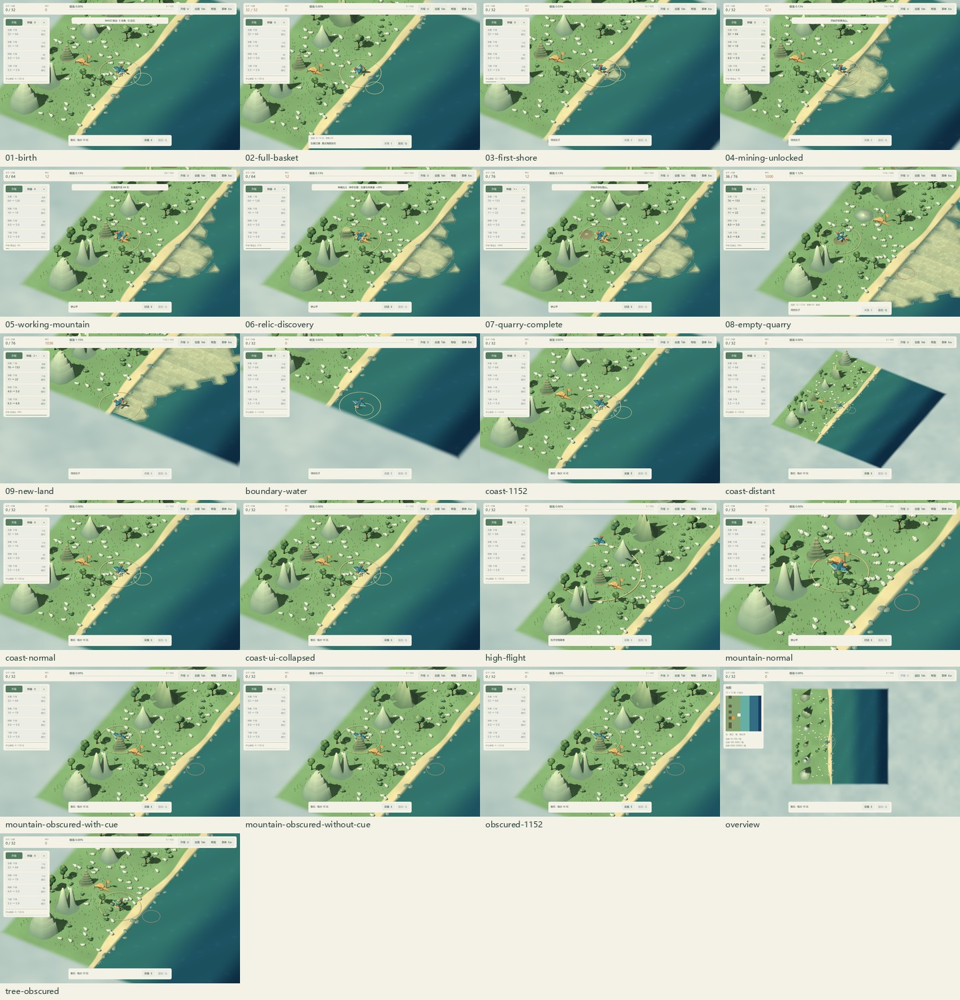
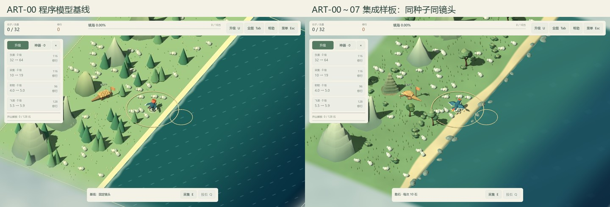
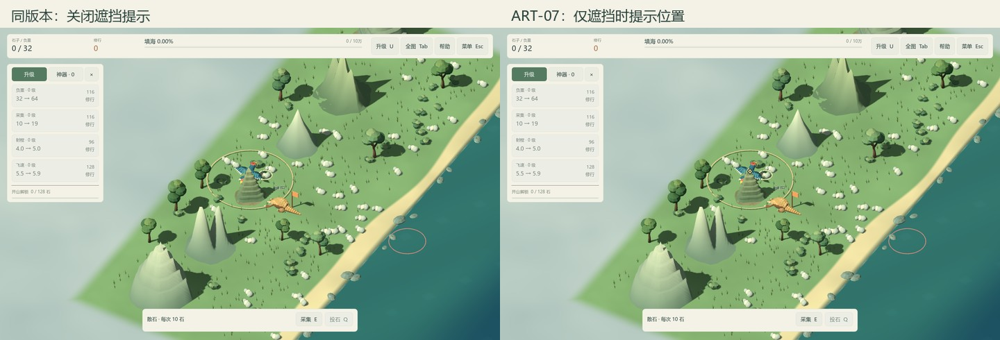
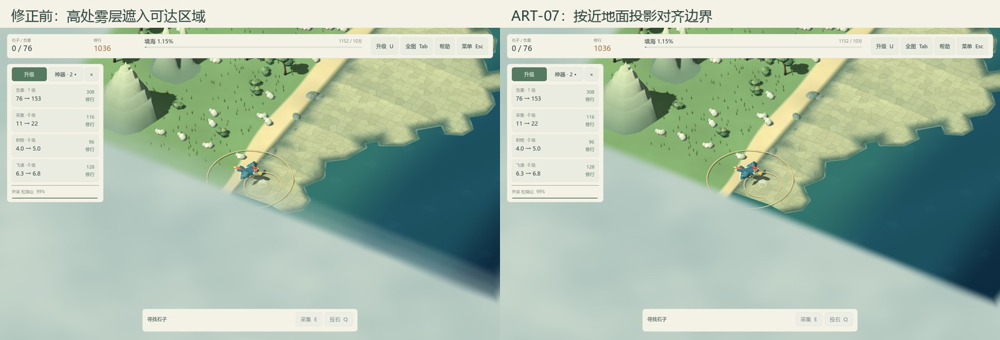

# ART-07 可玩海岸样板验收

日期：2026-10-15。工程：Godot 4.7.2 / Compatibility。结论：**本包交付完成，样板技术验收通过，可按已验证接口与预算进入 ART-08 资产扩展。** 当前记录是实机技术与画面审阅，尚无用户独立给出的最终审美批准，也不是发布版本或最低配置验收。

## 可直接游玩的入口

双击根目录 **Sample.cmd**。它沿用随附引擎和首次导入流程，进入固定种子 **10213、十万石**的普通游戏，使用正式精卫、穿山甲、第一类岩层山、海岸、神器与反馈。没有赠送资源、加速生产、改掉落或自动完成步骤。编辑器也可打开 `scenes/art/vertical_slice.tscn` 后 F6。

样板不读取或写入玩家旅程；启动器使用独立的 `artifacts/sample-profile`，菜单明确说明本次进度不保存。重新选图、手动保存和退出均不覆盖普通旅程。正常 **Play.cmd** 仍进入原游戏并正常续档。

操作沿用 WASD、E、Q/鼠标、空格、U、Tab、Esc、M。向大陆探索山体、向海扩大填海范围；升高可以投得更远。第一阶段重点观察初始海岸与第一座正式样板山，其余背景山型和资源变体仍属于 ART-08 的扩展范围。

## 完整资源循环实录

`tests/test_vertical_slice.gd` 在真实主场景以 60 Hz 物理移动、E 输入和正常投放入口完成路线；没有瞬移玩家、注入携带量、直接修改库存或跳过模拟时间。等待散石刷新、开山和神器均由普通物理帧推进。固定帧步长用于可重复验证和录制，不作为性能测量。

| 阶段 | 模拟时间（秒） | 携带 | 累计投海 | 第一座山库存 | 已填海格 |
| --- | ---: | ---: | ---: | ---: | ---: |
| 出生 | 0.0 | 0 | 0 | 0 | 0 |
| E 采集满背包 | 3.8 | 32 | 0 | 0 | 0 |
| 首次投海 | 6.4 | 0 | 32 | 0 | 2 |
| 四趟后解锁开山 | 56.2 | 0 | 128 | 0 | 9 |
| 接近穿山甲，检查对话暂停 | 59.4 | 0 | 128 | 0 | 9 |
| 神农石篓出土 | 82.0 | 0 | 128 | 0 | 9 |
| 第一座山完工 | 98.6 | 0 | 128 | 1,024 | 9 |
| 第一座山搬空，携带最后一包 | 219.2 | 36 | 1,116 | 0 | 24 |
| 最后一包形成新陆地 | 226.6 | 0 | 1,152 | 0 | 26 |

以上为录制批次的实际检查点，精确数据见 [流程记录](reference/art07/walkthrough.json)。普通采集的 128 石与第一座山的 1,024 石全部投入海里；购买负重花费 116 修行，最后余额 1,036。所有检查点均通过存档验证器检查资源与修行总账，搬空后的山不能再采集。单工人同时继续开采下一座山；录制末尾第二座山完工后，总生成量还包括其未搬运库存，并不把这些石料算作本轮已投海的 1,152 石。

[观看 14.5 秒实机短录像](validation/art07/resource-cycle.mp4)：720×510、H.264、无声、10 fps。按时间顺序保留实际飞行、投石落点、开山、出土、搬空与成陆片段，剪辑省略大部分往返与等待；不是一次 14.5 秒就能完成的游戏流程。完整路线约 3 分 47 秒模拟时间，录像与固定镜头截图均未访问玩家存档。

## 对照 ART-00 的画面审阅

对照图使用相同种子、出生位置 (-2.5, 3)、zoom=1、正交 size=29 与相机方向。左侧为 ART-00 程序模型基线，右侧为 ART-00～07 的集成结果；不能把此前各包的改进全部归因于 ART-07。骨骼姿势、灯光、植被避让与材质已在对应包更新。

| 镜头 / 项目 | 实际观察 | 结论与范围 |
| --- | --- | --- |
| 普通海岸 | 赤冠青羽与暖褐穿山甲可辨；资源比植被亮；新陆地石质面与原草地不同。水面高光比基线克制。 | 样板轮廓、资源层级与材质方向通过技术审阅；色彩偏好仍可按反馈调整。 |
| 山脚与工作位 | 第一座山岩层连续下降，角色与前爪可见；工作位可实际到达。矿场搬空后留下低矮山址。 | 实际路线无阻断采集或搬运的碰撞问题；连续断面、接缝和骨骼仍由专项回归覆盖。 |
| 山后、树后 | 低空部分身体会被正常几何遮挡。新增一个仅在遮挡时出现的金色小菱形，标出主角位置。 | 保留遮挡关系；不增加常驻文字，不把批量植被改成透明物体。 |
| 1152×720 | 顶栏与操作按钮完整，神器页可读，遮挡标记跟随投影位置。真实像素检查确认金色标记出现在对应位置。 | 小窗口实机通过，未用缩小大图替代。 |
| 拉远 zoom=2 | 仍能找到青羽角色和范围圈，动作及羽毛细节明显减弱。 | 使用大轮廓；不要求最远镜头辨认所有骨骼动作。 |
| 全图 | 使用原有位置标记和紧凑地图；隐藏草丛、灌木和升级侧栏，鸟的细节不承担导航任务。 | 不叠加第二个遮挡标记；全图不绕过投石射程。 |
| UI 开合 | 默认信息层级沿用既有 UI；U 可收起左侧升级栏，保留顶部资源与底部动作。 | 没有新增常驻标语、奖励面板或强制神器演出。 |
| 边界与成陆 | 修正高处雾层在斜视下遮入可达海岸的问题；近地参考投影让边界内海面和新陆地保持可见，范围外继续雾化。 | 图形像素对照验证边界内外，移动和投石边界规则没有变化。 |

镜头参数与尺寸见 [镜头记录](reference/art07/views.json)。独立记录：[正常](validation/art07/coast-normal.jpg)、[小窗口](validation/art07/coast-1152.jpg)、[收起侧栏](validation/art07/coast-ui-collapsed.jpg)、[拉远](validation/art07/coast-distant.jpg)、[全图](validation/art07/overview.jpg)、[高飞](validation/art07/high-flight.jpg)、[树后](validation/art07/tree-obscured.jpg)、[新陆地](validation/art07/09-new-land.jpg)。

## 本包修正与方案选择

**遮挡定位。** 比较后选择屏幕位置标记：增加一个忽略鼠标输入的 Control，不增加 3D 材质通道。山体使用真实碰撞射线，树冠使用生成时保留的近似球包络；最多 200 个包络，以 10 Hz 检查，标记位置随相机更新。海上与全图跳过检测，暂停隐藏，换图清空旧结果。树冠包络是定位辅助，不承诺逐像素遮挡分类。

另一种方案是角色穿透轮廓，需要额外绘制并校对角色各个网格；按遮挡淡化树木则会涉及现有 MultiMesh 的逐实例透明、排序与阴影处理。本包没有引入这两种更复杂的渲染路径，也没有通过取消山体碰撞解决遮挡。

**边界迷雾。** 原来三个不同高度的雾平面按自身 XZ 判断边界，在斜视投影中会遮住边界内几单位的地面。现在沿正交相机视线投到 y=0.2 的近地海岸参考平面，再判断范围和柔和过渡；保留三层噪声、暂停时钟和范围外雾化。该参考面是海岸高度的近似，不是屏幕深度重建或体积雾。

## 性能记录

单独使用实时钟运行 `tests/art_slice_benchmark.gd`，禁止无窗口和固定帧率模式。1440×900、2× MSAA、Compatibility / OpenGL 3.3，RTX 4060 Laptop GPU、i9-13900HX。每场景预热 3 秒；海岸采样 16 秒，覆盖一次 14 秒散石刷新，其余各采样 8 秒。正式主场景的物理、资源同步、动画、UI、遮挡检测和效果池均运行；静音、关闭 VSync、不限帧。

<!-- PERFORMANCE_BEGIN -->
| 场景 | p95 帧间隔（ms） | 最大单帧（ms） | 绘制调用中位数 |
| --- | ---: | ---: | ---: |
| 海岸移动、采集与投海 | 1.359 | 17.142 | 135 |
| 矿场采集、落地与拾回 | 1.485 | 14.323 | 139 |
| 绕山低空飞行与遮挡定位 | 1.316 | 13.855 | 116 |
| 一亿石地图全图 | 11.013 | 15.572 | 85 |
<!-- PERFORMANCE_END -->

详见带硬件、设置、有效事件数和资源验证结果的 [性能摘要](reference/art07/performance-summary.json)。逐帧原始数组保留在忽略的 artifacts。矿场场景在计时前通过状态规则准备已完工快照，采样中正常采集并把落地石堆拾回；海岸为实际移动、采集与投海。预热末尾的飞石可能在采样中落地，因此落点数与本段起投数未必相同。

这些是当前桌面上的短时 CPU 帧间隔，包含桌面调度，不是 GPU 时间、独占设备、发布构建或长时峰值。没有在本包据此宣称 1920×1080 稳定 60 帧、集显达标，或与 ART-00 的波动结果进行性能收益归因。完整扩展地图、长时压力、1080p 与低画质档继续由 ART-08/09 验证。

## 自动验证与源码分发

默认 Test.cmd **926 项，0 失败**：原有 877 项，加上 33 项实际路线与 16 项样板隔离/遮挡检查。实机资源循环 **33 项**，带镜头截图与像素读取的图形审阅 **31 项**。原角色、环境、投石高度、音频、UI、存档和完整填海检查全部保留。

`tools/verify-clean-art-copy.ps1 -Destination artifacts/art/clean-art07-20261015` 从无缓存、无制作库、无已解压引擎的源码副本开始，由随附 ZIP 准备 Godot，通过全套 926 项，并额外通过 **Sample 启动器的首次导入/启动检查**。玩家运行不需要 Blender、Python、ffmpeg 或网络。制作库、原始帧、视频编码器、日志与玩家保存副本均被忽略；提交的是源资产、可运行代码、审阅图和压缩短录像。

## 问题清单与阶段出口

| ID | 状态 | 复现 / 影响 | 处理 |
| --- | --- | --- | --- |
| VS-01 | 已修正 | 第一座山背向镜头的一侧，低空身体被遮住；树冠下同类情况。 | 条件定位标记；山后/树后、小窗口、高空、暂停、全图、换图均验证。 |
| VS-02 | 已修正 | 最后一包投向靠近 z=24 的海格，斜视雾层覆盖可达的新陆地。 | 近地参考投影；边界内水面与范围外水面做实际像素开关对照，并重录成陆画面。 |
| VS-03 | 待 ART-08 | 第一类以外的背景山仍使用原有程序轮廓；散石和其他矿场组合变化少。 | 按已验证的岩层/库存接口扩展山型、石形和植被组合，不把当前背景称作完整成品资产。 |
| VS-04 | 待用户反馈 | 整体色彩、鸟的比例、颗粒效果强度属于审美偏好；尚无独立最终批准。 | 保存同镜头图与可游玩入口，后续反馈回到对应资产包修正。功能检查不代替审美认可。 |
| VS-05 | 待 ART-08/09 | 当前只覆盖本机短时负载，缺少集显、1080p 长时玩法与发布构建测量。 | 全量扩展后记录最慢场景、峰值、低画质策略和支持设备，不提前写最低配置。 |

当前样板没有遗留阻断本轮资源循环的碰撞或结算问题，也未观察到正式角色的明显破面或已改造海床的跨区块接缝。已冻结的样板预算和保留的扩展边界见 [风格规范](style-guide.md) 与 [资产清单](asset-inventory.md)。这些结论仅覆盖记录的镜头、路线与专项，后续扩展仍需要回归。

下一包 **ART-08：全地图资产扩展与性能优化**，优先把经过本包验证的山体、库存与材质接口扩展为多种独立轮廓，再检查四档地图的重复感与负载。
