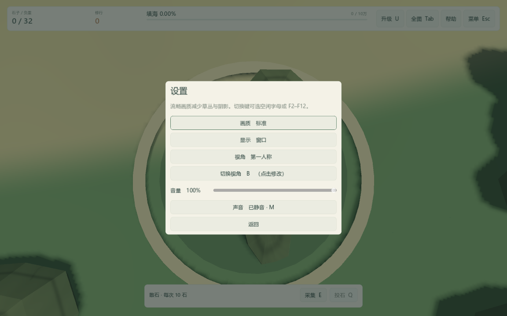
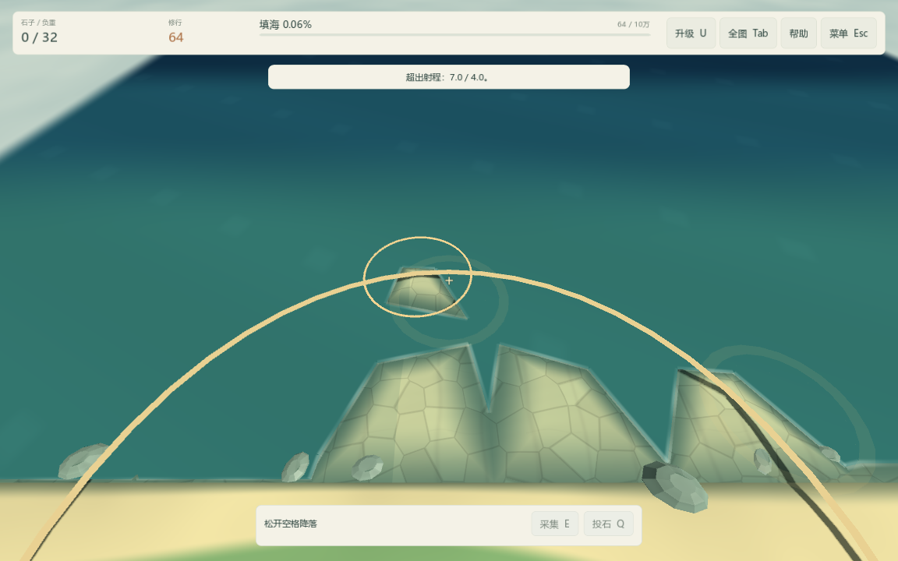

# FP-01：第一人称基础与视角改键

2026-10-16，版本 0.5.0。第一人称任务分为 FP-01 基础可玩、FP-02 观察和交互打磨、FP-03 专用动作，详见 [任务包](../release-tasks.md)。先交付 FP-01，之后继续 FP-02。

## 操作与设置

默认仍为随行视角。V 切换第一人称，鼠标转向，WASD 按观察方向在水平面飞行。空格升高、松开下降，原有飞行高度和射程加成保留。俯仰限制为向下 85°、向上 80°，不加入镜头晃动。镜头采用 75° 透视视野，贴近精卫头部位置，隐藏自身模型以免挡住视线。

Q 和左键都投向屏幕中央准星。瞄准天空、地图外或被山挡住的位置不会投石；超出原水平射程不会消耗石子。海岸、海面和填出陆地参与瞄准，投向大陆仍可拾回。E 继续按附近距离采集、对话，保持低空限制，不要求精确瞄准散石。

Esc 暂停、Tab 全图、U 展开升级栏时释放鼠标，返回后恢复观察；窗口失去焦点时暂停并释放鼠标。Tab 返回进入全图前的视角。切入第一人称自动收起升级栏，退出游戏也释放鼠标。

Esc → 设置新增视角选择及“切换视角”按钮。点击后按空闲字母或 F2–F12 完成绑定，Esc 取消。WASD、E/Q、U/M、方向键、空格、Tab、Esc、F1 与 F4 保留；不支持组合键。旧绑定被实际移除，避免两键同时切换。视角与绑定存入独立 preferences.json，旧偏好缺少字段时使用随行 / V，旅程保持 v3 格式。

## 实现与边界

沿视线逐格遍历地图，只检测穿过的格子；复用填海地形的三角面、海岸分段和水平海面求最近交点，再用现有山体物理碰撞排除遮挡。计算量随穿过的网格数增长，不扫描整张地图。树叶、灌木仍是装饰，不新增物理遮挡；水面按平均高度瞄准，不追踪每一道波纹。投石仍调用原结算，不增加射程或离线收益。

第一人称石子从镜头前方出手，省略贴脸起手光环，落水、成陆、完成和音效仍走原表现流程。专用翅膀与携石动作属于 FP-03。

## 验证

完整源码回归通过，覆盖原规则、旧档、加载、设置、音效、美术、反馈与玩法。新增 tests/test_first_person.gd 已接入 Test.cmd：覆盖四档地图 × 标准/流畅画质，验证改键冲突和取消、旧键失效、实际偏好文件重启恢复、朝向移动、准星 Q / 左键、高低空射程、陆地投石与拾回、采集和 NPC 对话、山体遮挡、全图往返、暂停与失焦释放鼠标。该脚本显式隔离存档，不能使用会禁用偏好读取的 --qa。

无画面检查 100 项、实际 OpenGL 窗口检查 102 项均通过。整套原回归 1,812 项通过；新增共计 1,912 项源码检查。实际窗口额外检查鼠标捕获和俯仰限制，并检查 1152×720 设置布局与海岸画面。只排除当前环境已知的根证书库读取诊断；脚本错误及其他错误均判定失败。

Windows 独立构建工具同步升级到 FP-01 / 0.5.0，并增加挂载实际导出 PCK 的第一人称无画面/真实窗口检查，以及真正发行 EXE 的第一人称偏好启动截图。每次构建的源提交、文件校验值和验收结果由 build-info.json 与独立 verification.json 记录。

FP-02 继续处理灵敏度 / 视野调节、近景视觉和更明确的交互反馈；本包没有进行长时间第一人称性能测试，也未验证其他显卡。截图中的数据来自隔离测试旅程。
