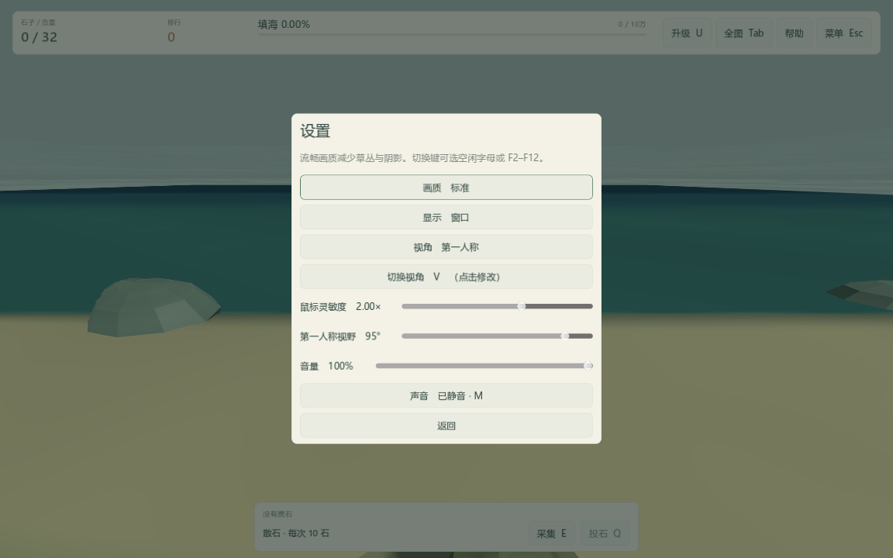
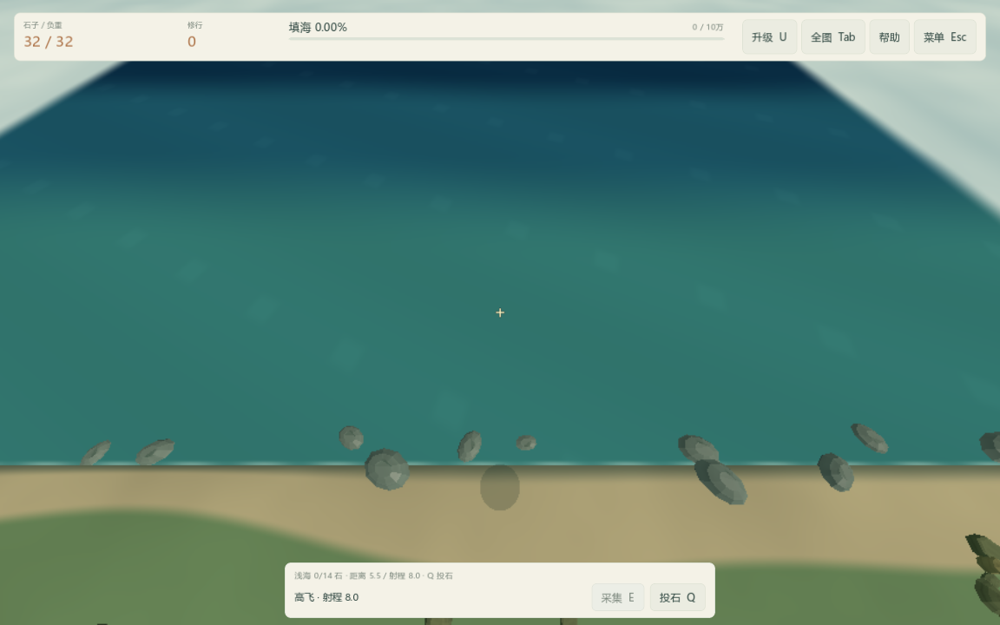
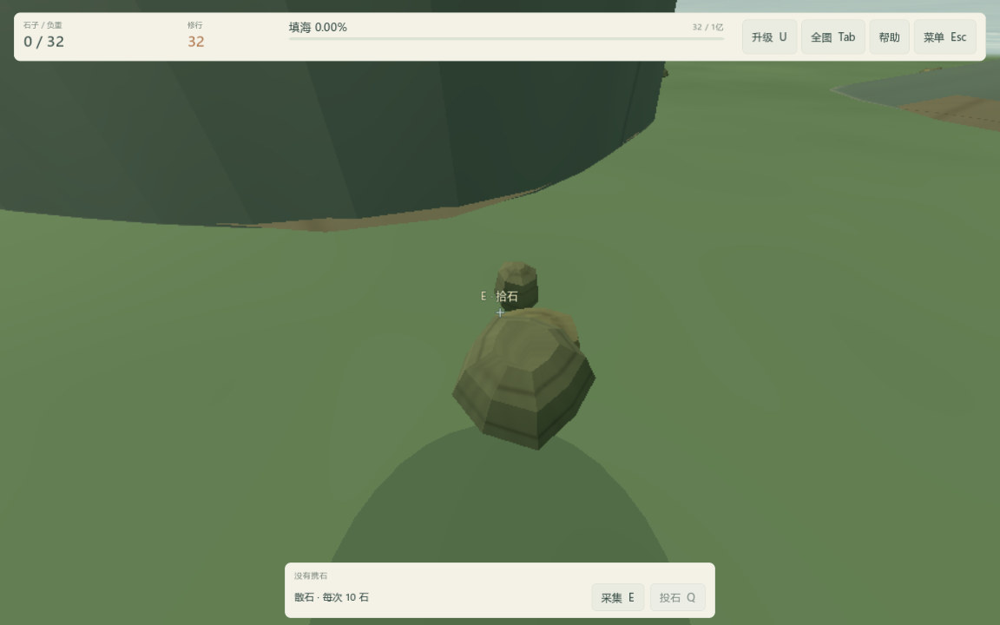
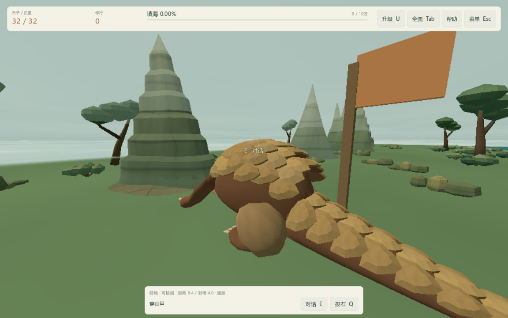

# FP-02：观察设置、近景与目标提示

2026-10-16，版本 0.5.1。完成 [第一人称第二包](../release-tasks.md)，下一包为 FP-03 专用翅膀、携石与投掷动作。

## 玩家可见变化

- Esc → 设置增加鼠标灵敏度 0.25–3 倍，以及第一人称视野 60–100°，默认 1 倍 / 75°。滑块即时生效，连续拖动合并保存，返回菜单时也会保存。旧设置自动补默认值，切换地图、画质或重启后保留。
- 第一人称收起地面射程圈、落点圈和采集圈，改用金色可投准星、红色超距准星与底部距离说明。天空、地图外和山体遮挡有对应文字；有效落点继续按原射程结算。
- 视野内的附近散石、落地石堆、碎石场与穿山甲显示简短 E 提示。优先顺序与实际采集一致，负重满或飞得过高时不显示采集提示；背后或被山挡住的目标不显示浮动标签，底部仍提供附近状态。
- 第一人称隐藏穿山甲的较大头顶文字。贴近镜头的装饰植物在约 0.45–0.95 单位内渐隐，采集碎屑在到达镜头前缩小；山体碰撞保持有效。植物仍是装饰，不增加碰撞。
- U 打开第一人称升级栏时，场景与反馈效果一起暂停，释放鼠标；关闭后恢复。全图与随行视角恢复原有地面标记和植物显示。

观察偏好仍独立于 v3 旅程存档。海岸、矿山、石料总量、修行与高飞增程继续使用原规则。

## 检查与采样

完整源码回归通过。原 1,912 项加本包最终 102 项，共 2,014 项（本包最后追加的 4 项单独补测）。真实 OpenGL 窗口另通过 104 项本包检查，覆盖实际鼠标角度、粒子几何缩小、1152×720 设置布局、四档地图与两档画质、旧设置兼容、偏好重启恢复、目标提示、视角/全图恢复及升级栏暂停。截图来自隔离测试旅程。

近处植物的同位置对比见 [原遮挡](validation/fp02/foliage-solid.png) 与 [近景渐隐](validation/fp02/foliage-clear.png)。渐隐使用不透明材质的像素筛除，避免引入整片透明植物的排序问题。

性能采用同设备、1440×900、Compatibility 的八段脚本巡游，每种地图/画质真实运行 8 秒；分别采样 FP-01 正式 PCK 和 FP-02 工作区源码。两者均由明确指定的编辑器引擎运行。每版累计约 64 秒路线采样，不包括加载/准备时间，不是长时间压力测试或发行 EXE 的手动游戏帧率。

这轮帧间隔 P95 约 5.7 ms；最大地图界面与瞄准更新 CPU P95，标准档从 6.33 降至 3.11 ms，流畅档从 6.88 降至 2.70 ms。瞄准计算复用相同地形顶点，省略不需要的法线计算，并快速排除从地面上方看向天空的射线。仍观察到约 55 ms 的个别帧，不能据此声称无卡顿。实际引擎进程工作集的 1 秒采样峰值由约 411 MiB 到约 404 MiB；每版 25 项路线/资源守恒/节点清理检查通过。完整数据与限制见 [采样表](validation/fp02/table.md)。

复现入口：Test.cmd 包含功能检查；tools/measure-first-person.ps1 生成真实窗口巡游、帧间隔和进程内存记录。前后数据均隔离 APPDATA / LOCALAPPDATA，不读取玩家旅程。仅过滤本环境已知的根证书库读取诊断，其他错误以及泄漏警告会使独立包验证失败。

Windows 构建与验收工具已更新为 FP-02 / 0.5.1，包含实际导出 PCK 的本包检查及发行 EXE 读取 95° 视野偏好的续档截图。每次导出的源提交、哈希与验收结果分别记录在 build-info.json 和 verification.json。未进行其他显卡、长时间运行或眩晕舒适度的用户体验验收。
