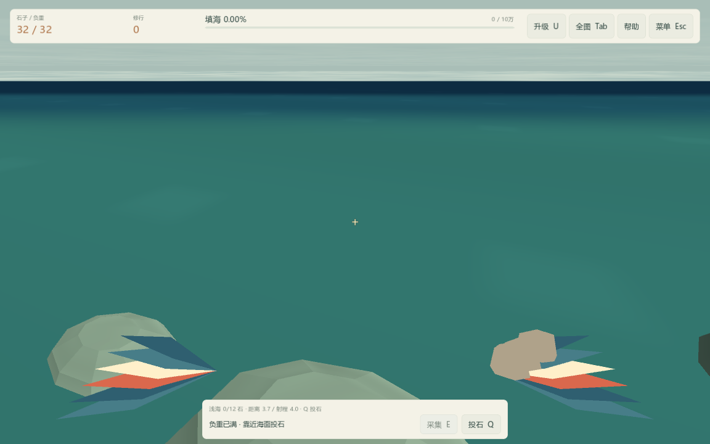
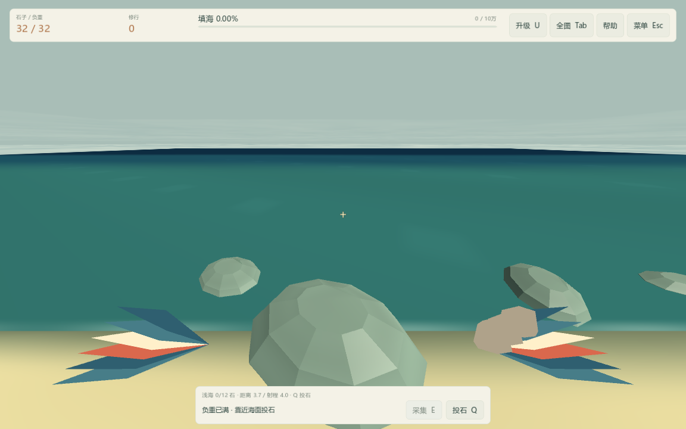
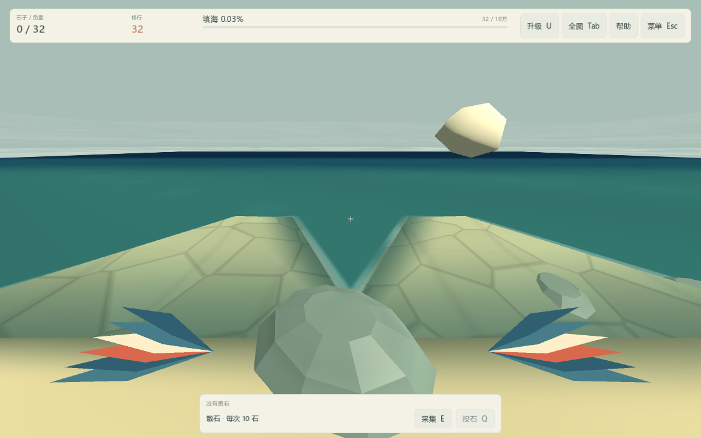

# FP-03：第一人称翅膀与携石动作

2026-10-16，版本 0.5.2。完成第一人称第三包，后续接回 QA-05 自动保存响应性与失败恢复。

- 第一人称两侧下方增加低多边形羽翼，沿用精卫青蓝、米白和朱红配色。悬停轻动，移动或高飞时加快振翅，不给相机增加晃动或滚转。
- 右侧携石按空载、少量和满载显示；成功采集时收翼，成功投石时展开并清空携石表现，石子从右侧衔接原有飞行轨迹。动画时长分别 0.42 / 0.48 秒。
- 羽翼使用独立相机局部网格，按视野角调整横纵比例，保持中央瞄准空间；关闭深度测试和投影，避免近处地形切掉自身羽翼。该模型只用于第一人称，原精卫模型与动画不变。
- 暂停和升级栏冻结动作；全图、原视角、加载期间隐藏，切回不重播旧动作。换地图释放旧模型。没有新计时器或延迟资源结算，采集与填海仍共用原有成功事件、音效和落地反馈。

## 验证

完整源码回归通过 2,054 项，追加实际采集与资源守恒检查后，本包 42 项单独通过，合计覆盖 2,056 项。实际 OpenGL 窗口本包 42 项通过，截图为隔离测试旅程，覆盖三档视野、携石数量、成功/失败投石、真实 E 采集、动画后资源守恒、暂停、升级栏、全图、视角与换图清理。原 FP-01/02 的四档地图、两档画质及设置保存回归继续通过。

模型由脚本生成 12 片带脊线羽毛与最多 3 块携石；在加载阶段创建，纳入现有渲染预热。没有新增贴图、外部模型依赖或存档字段。Test.cmd 与独立包验收工具已包含本包检查；导出记录保留源提交、版本与文件哈希，验收分别运行实际 PCK 的深度检查和发行 EXE 的启动截图。仅过滤本环境已知根证书库读取诊断，其他错误和泄漏警告不忽略。

本包是本机功能与画面验收，未追加长时间性能采样、其他显卡或真人眩晕舒适度测试。截图只代表记录的动作阶段，后续可根据实际游玩反馈调整羽翼造型和幅度。
