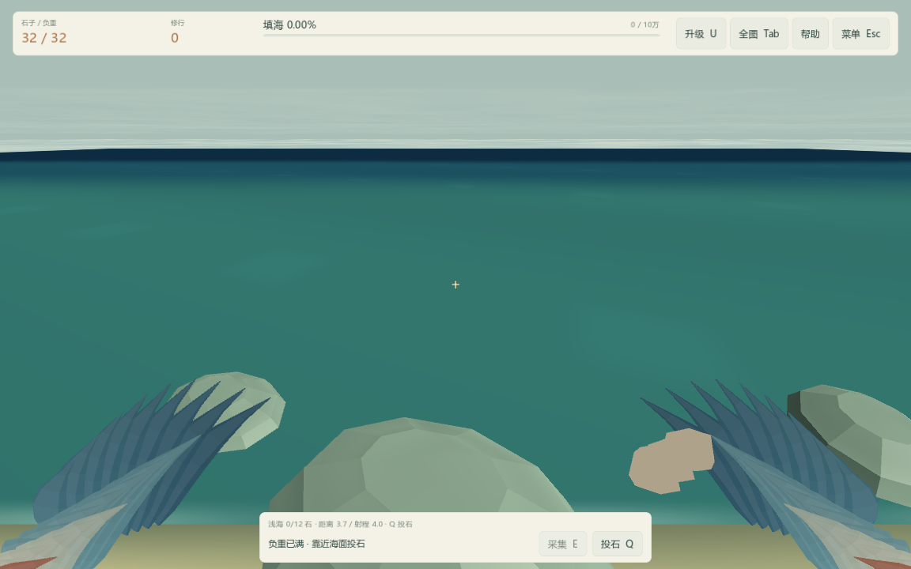

# 第一人称羽翼重做 · 0.5.4

根据玩家对原羽翼造型的反馈，替换平面彩条尖片：从画面两侧下方延伸完整弧形翼面，每侧 9 根长飞羽、7 根中层覆羽、5 根浅色短覆羽和 3 根暖色肩羽。羽面具有弯曲的截面与明暗，采用青蓝主色、米灰浅层和少量暖色，减少大面积亮白与红色条纹。

两侧各合为一份网格，固定顶点配色，避免逐帧重建。只绘制面向镜头的半侧羽面，关闭深度测试时也不会让背面穿透形成三角噪点。振翅加入轻微倾转，移动/悬停幅度平滑过渡；不改变相机角度、采集结算或射程。

真实窗口第一人称动作检查 42 项通过，查看 60°、75°、100°、采集及投掷截图。以下为隔离测试旅程的 75° 画面。整体偏风格化，未进行真人审美或舒适度验收。

