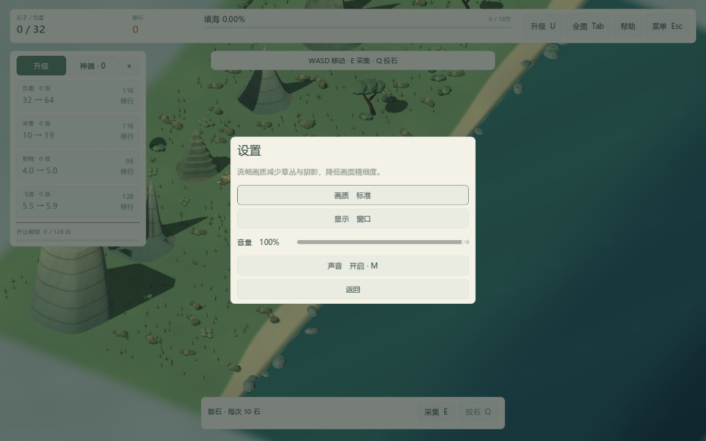
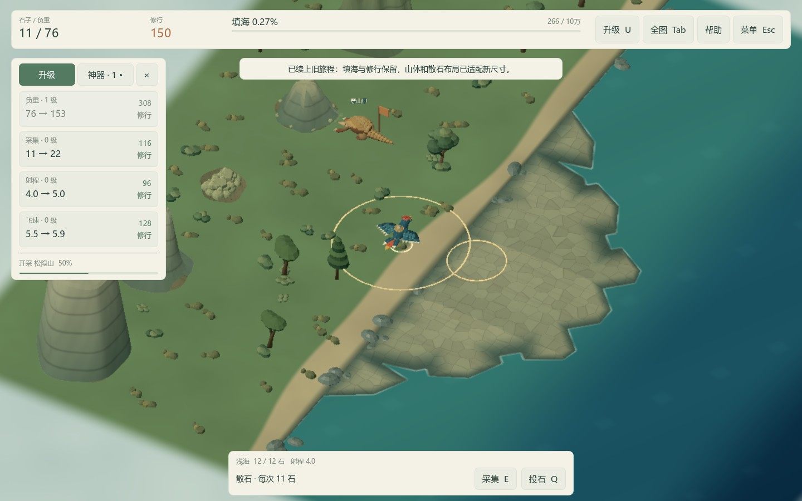

# QA-01：画质、显示与声音设置

日期：2026-10-16。版本：0.2.0。接续 BUILD-01 的独立 Windows 试玩包；状态：已完成。

## 玩家可见变化

按 Esc → 设置，调整画质、窗口/全屏、音量与静音。标准档保持原有画面；流畅档隐藏装饰草丛、关闭太阳实时阴影和 MSAA，将 3D 渲染比例设为 75%。树木、山体、石料、边界迷雾与可交互目标保留；界面文字仍按完整窗口分辨率绘制。



音量即时影响游戏专用声音总线，包含采集、投石、落点、发现与海浪。调到零或静音会清掉旧声音并使未落地声音失效；重新打开声音不会补播。M 与设置页保持一致。修正键盘选中按钮时文字过浅的问题；设置页可用 Tab、方向键和确认键操作。

设置只出现在暂停面板，不增加常驻 HUD。调节期间世界仍暂停；“返回”回到暂停菜单，Esc 返回游戏。偏好写入 `%APPDATA%/AzVGames/Jingwei/preferences.json`，与旅程 JSON 分开，重开地图或重新启动会保留。音量滑动合并写入，离开菜单与正常关闭窗口会立即保存；写入失败保留运行中的设置并给出提示。

## 验证与证据

原有 1,615 项检查继续通过；新增偏好专项 50 项，总计 1,665 项。专项涵盖数据类型、损坏/超大文件、默认值、原子写入与备份恢复，实际按钮/滑条、声音总线、零音量、M、暂停、重新启动、重新选图和样板隔离。四档地图逐档验证流畅/标准切换、全图往返、碰撞与资源账本不变。1152×720 真实窗口另验证全屏切换与设置布局，共 53 项。

实际 ZIP 解压至含中文和空格的新目录，原 36 个 GLB、19 个声音与图标的打包核查 226 项通过；挂载实际 PCK 的存取档回归 107 项分别在无窗口和真实窗口通过，新增偏好专项也在 PCK 中重复运行。玩家 ZIP 不含测试、编辑器、制作工具或个人偏好文件。

release 模板不支持 --script，深度回归通过显式编辑器检查程序挂载 PCK 完成。真正的 Jingwei.exe 另做四档画面捕获、普通新开局、加载 v2 旅程以及读取已保存的流畅/音量/静音偏好。最后一项使用引擎录像接口捕获普通启动帧，没有使用会禁用存档读取的 --qa/--capture 路径。



设备仍为 i9-13900HX、RTX 4060 Laptop、NVIDIA 581.57、Windows 10.0.22631、Godot 4.7.2 Compatibility。截图为本包候选运行画面；最终已提交源码另建 ZIP，并用相同工具完整复验。没有据此宣称核显或最低配置达标，也没有把功能截图当作性能对比。长时运行留给下一包。

## 重建与验收

```powershell
./Test.cmd -NonInteractive
./tools/build-windows.ps1 -Destination builds/Jingwei-QA-01-Windows-x64
./tools/verify-windows.ps1 -ZipPath builds/Jingwei-QA-01-Windows-x64.zip -Destination "artifacts/QA-01 最终交付验证"
```

导出模板仍沿用 BUILD-01 已校验的官方 4.7.2 模板。工具记录来源提交、是否有未提交变化、程序版本、ZIP 大小与 SHA-256；正式交付从干净的已提交代码生成。验证存档全部位于独立目录，源码测试和样板不会读取或覆盖玩家偏好。新设置不会进入 version=3 的旅程资源账本，旧版也可继续读取旅程。

本包基线为 `f29cdc50ac8a4a080eaa94d50c117a576827c24a`。回退前备份整个存档目录；旧版忽略新增 preferences.json。仍为未签名 Windows 便携试玩包，未发布商店。下一包 QA-02 范围见 [发行准备任务](../release-tasks.md)。
