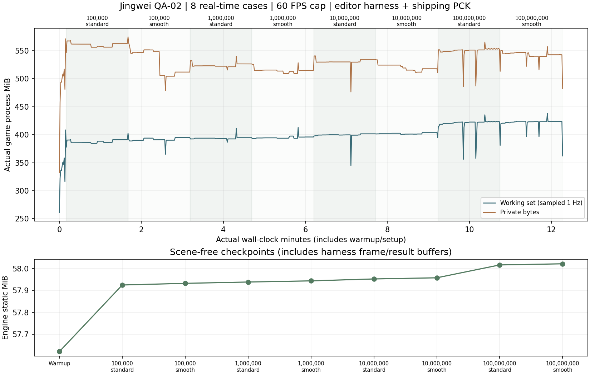

# QA-02：持续运行与存档稳定性

日期：2026-10-16。基线：QA-01 / `510628d662f6735086375208c883fd32641859e7`。游戏版本沿用 0.2.0，本包增加验证工具、证据和验收交付，未更改玩法或存档格式。

## 测量方法

四档地图 × 标准/流畅，两种画质各跑 90 秒，共约 12 分钟实际计时。使用 1440×900 Compatibility、60 FPS 上限、真实时钟与真实图形输出；不使用固定步长录制、time_scale 加速或无窗口渲染冒充持续运行。前置暖机、开图与清理时间另计。所有旅程、偏好、损坏主文件夹具和重开归档均在新建 artifacts 目录，正常存取档开启，不读写玩家数据。

检查程序显式挂载 QA-01 的实际 Jingwei.pck；资源来自打包文件。由于 release 模板没有 --script，持续运行使用编辑器检查程序，不将这批帧时间写成 release EXE 的性能成绩。最终 QA-02 独立包另执行真实 release EXE 的启动、旧档、画质及打包回归。

每场包含：普通采集和投海入口、真实暂停、完整海域压力场景、重复保存与读回、释放后重载、全图往返、故意损坏测试主存档后从备份恢复，以及通过暂停菜单归档并切换两次规模。粒子持续占用固定的 12 飞石/24 扩散/3 神器池，声音调度照常运行，仅静音测试进程的 Master 总线。低空采集通过定位角色调用普通入口，属于自动驾驶夹具，不能当作手工路线试玩。

完整海域夹具明确补记生成石料；每场额外推进 43 秒开采，只是准备开采状态。生成数量和加速的模拟秒数单独列入 JSON，不能相加为真实运行时长。每次保存检查资源守恒，石料、修行等整数严格一致；小数的 JSON 读回只容许 `max(1e-12, max(abs(a),abs(b))*1e-14)` 的末位误差。备份保留则直接核对文件字节。

宿主每秒记录游戏自报 PID 对应的工作集、私有内存和累计峰值，不采启动辅助进程。每场结束释放主场景后等待渲染/音频回收，再检查旧世界与效果池弱引用、节点/孤儿节点、资源数和引擎静态内存。逐帧间隔包含存档、重载和切图停顿；操作耗时另外记录，不从报告隐藏卡顿。

帧间隔由独立节点逐帧采样，检查程序主动等待回收时仍继续采样；不会把这些等待合并成一帧。清理后的静态内存仍含检查程序的帧数组与结果记录，独立采样节点也仍存在；不能把首尾差值直接叫作游戏泄漏。节点、孤儿节点和资源数另行核对。

## 实测结果

正式数据完成后，由 `tools/package-stability-report.py` 归档为 [摘要](validation/qa02/summary.json)、[逐场表格](validation/qa02/table.md) 和内存图。原始帧、逐秒进程数据及隔离旅程保留在 artifacts，不提交个人存档或大批测试产物。

<!-- QA02_RESULTS_BEGIN -->
状态：已完成有限时长稳定性验收。8 场实际计时合计 **721.02 秒**，含暖机、建图和清理的引擎会话 **736.88 秒**，宿主记录 **739.08 秒**。采集 **40,156 帧**和 **726 个进程内存样本**。本轮独立采样器还检查自身在生命周期协程等待期间继续记录帧，第一轮合并工具等待的帧数据已弃用，不进入本报告。

**1,066 项稳定性检查、0 失败**：28 次主场景创建/重载、16 次规模重选、398 次显式检查保存、8 次损坏主文件后的备份恢复；398 不包含主场景自动保存与重开隐式保存。普通入口实际采集 374 次、投海 86 次。夹具合计补记 333,296,996 石并推进 516 秒模拟开采，均包含暖机准备，未计作额外真实运行时间。

所有清理点节点均为 **2**（根窗口与独立采样节点）、孤儿节点 **0**、资源数 **93**；旧世界和效果池弱引用全部失效。引擎静态内存由暖机后的 57.62 MiB 到最后清理点 58.02 MiB，差约 0.40 MiB；同规模标准/流畅清理点的差值均小于 0.008 MiB。进程工作集采样峰值 **438.14 MiB**，系统累计峰值 **445.18 MiB**（含开图/暖机）。这些计数与趋势没有显示场景节点/资源数累积，不等于证明数小时或所有设备无泄漏。



| 目标 / 画质 | 实际秒数 | 帧数 | p95 / p99 / 最慢 ms | >33.33ms 帧 | 清理后静态 MiB |
| --- | ---: | ---: | ---: | ---: | ---: |
| 10万 / 标准 | 90.03 | 5353 | 17.68 / 21.16 / 426.54 | 6 | 57.92 |
| 10万 / 流畅 | 90.02 | 5373 | 17.77 / 21.49 / 169.92 | 9 | 57.93 |
| 100万 / 标准 | 90.02 | 5366 | 17.80 / 27.08 / 229.18 | 10 | 57.94 |
| 100万 / 流畅 | 90.02 | 5370 | 17.87 / 25.84 / 213.31 | 10 | 57.94 |
| 1000万 / 标准 | 90.08 | 5179 | 18.03 / 68.76 / 561.36 | 55 | 57.95 |
| 1000万 / 流畅 | 90.09 | 5181 | 18.02 / 67.51 / 554.66 | 55 | 57.96 |
| 1亿 / 标准 | 90.37 | 4171 | 18.70 / 371.66 / 1751.68 | 52 | 58.02 |
| 1亿 / 流畅 | 90.37 | 4163 | 18.70 / 374.67 / 1747.82 | 52 | 58.02 |

**仍有停顿。** 最慢实际帧间隔 1.75 秒；最慢的完整“损坏主文件 + 恢复 + 重载”操作耗时 2.19 秒，包含主动等待回收，因此不是一帧时间。压力流程还包含检查程序的额外读回、递归账本对比与夹具构造，不能把全部开销归因于普通游玩/自动保存，也不能据这张表评价流畅档的纯 GPU 收益。CPU 帧间隔不是 GPU 呈现时间，60 FPS 上限也不代表锁定 60 帧。开图/重载的响应性列入 QA-03，未在本包擅自改写加载或存档流程。

原有 **1,665 项 Test.cmd 检查继续通过**。本轮未发现需要修改游戏结算、备份或场景释放实现的问题，运行代码/模型/音效/配置与 QA-01 相同；新增的是验证工具、报告及 QA-02 打包标识。最终 ZIP 从已提交源码生成，并继续执行独立包 226 项资源核查、107 项存取档、50/53 项设置检查与真实 release EXE 启动/续档验证。来源、文件校验值和日志写入 `artifacts/QA-02 最终交付验证/verification.json`。
<!-- QA02_RESULTS_END -->

## 复现

```powershell
./tools/measure-stability.ps1 -Output artifacts/qa02-new -CaseSeconds 90 -PackPath builds/Jingwei-QA-01-Windows-x64/Jingwei.pck
python tools/package-stability-report.py --source artifacts/qa02-new
./Test.cmd -NonInteractive
./tools/build-windows.ps1 -Destination builds/Jingwei-QA-02-Windows-x64
./tools/verify-windows.ps1 -ZipPath builds/Jingwei-QA-02-Windows-x64.zip -Destination "artifacts/QA-02 最终交付验证"
```

工具拒绝重复覆盖输出目录，并带超时与错误诊断监控。`-CaseSeconds 3` 只做快速预检，较重操作可能延长短预检；不能包装成 12 分钟报告。正式采样还要求足够的真实帧数，暂停进程或系统睡眠不能代替负载运行。持续运行不加入默认 Test.cmd，避免每次小改动都等待 12 分钟。

报告整理工具需要 Python 与 `tools/requirements-stability.txt` 中的 Matplotlib，仅用于制作机绘图，不进入玩家包。它拒绝短预检、未完成/失败记录以及旧的协程间隔采样数据，核对实测 PCK 与构建来源的 SHA-256。

独立包仍为未签名 Windows x86_64 便携试玩版；持续运行结果不代表数小时稳定性、核显/最低配置、新系统安装、不同驱动、电源和温控状态达标。发现和仍需处理的事项以实测记录为准。
