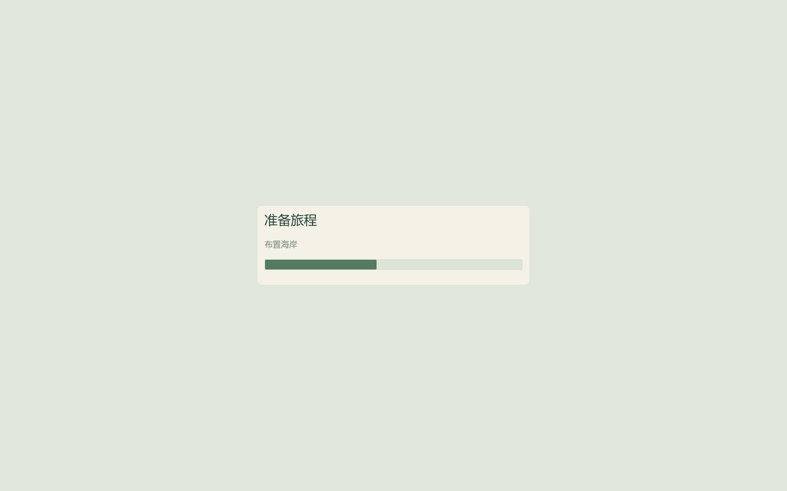

# QA-03：分阶段加载与等待反馈

Windows 试玩版 **0.3.0**。开图、续档和重选规模显示简短阶段与进度条，完成后恢复操作。进度是构建阶段与已完成批次的提示，不是剩余秒数预测。沿用 v3 旅程、v2 迁移、四档规模与原有石料/修行规则。



存档读取、验证与地图数据生成使用独立后台任务；重开前的保存/归档和新地图首次保存也在冻结操作后完成。场景树与渲染资源仍在主线程建立，植被、山体、碰撞和已填海面按批处理，工作批次达到约 6ms 时让出下一帧。单次资源创建、地形块提交或驱动工作可能超出预算，不能据此宣称每帧都小于 6ms。

植被摆放先缓存不变的山体范围与工人位置，减少反复读取山体字典与半径；不改石子、山体库存或随机海域容量。构建中的画面由不透明等待面板遮挡，渲染器可分阶段准备材质。整个 3D 树隐藏到末尾会使首次绘制过于集中，已避免这种处理。

加载期间移动、拾石、投石、菜单与重复地图请求均停用；自动保存也跳过中间状态。旧场景释放后再分配新场景，旧效果和声音调度失效。原存档备份失败则保留当前世界和数据、恢复规模选择；读取中释放场景会先等文件任务结束。普通退出的保存入口同样检查加载状态，不会写入半成品世界。

## 验证与实测

默认 Test.cmd **1,790 项**通过，含新增加载专项 **125 项**。覆盖四档新图、满海域续档、损坏主文件恢复、归档重开、重复点击、Esc、无有效存档、备份写入失败和读取中释放场景；原有偏好、v2 迁移、资源守恒和完成反馈测试继续通过。诊断与捕获入口同步等待地图完成，不再以一帧等待假定加载已经结束。`choose_world()` 返回请求是否受理，完成由 `wait_until_ready()` 等待。

图形对比使用显式编辑器检查程序分别挂载 QA-02 正式 PCK 与 QA-03 导出候选 PCK，未回退读取源码资源。设备 i9-13900HX / RTX 4060 Laptop / NVIDIA 581.57，Compatibility，1440×900。两组都创建全新隔离用户目录；不强制清空系统驱动缓存，因此不能将其解释为受控的全冷启动基准。后台加载的实际线程调度、首个完整世界的绘制、必要的归档/首次保存均计入操作时间。

独立节点每帧采样，完成后继续记录两帧，覆盖最后一次地图显示产生的绘制等待。PNG 审阅捕获在计时之外。早期未包含最后绘制间隔的试验数据不进入下列报告。夹具通过正常账本显式注入目标数量石料并填满海域，属于资源守恒的测试状态，不是手工通关。

| 一亿石地图 | 旧版总时长 → 本版 | 旧版最长帧 → 本版 |
| --- | ---: | ---: |
| 选择新地图 | 855.51 → 605.36ms | 844.96 → 30.12ms |
| 满海域续档 | 1033.44 → 810.55ms | 992.73 → 29.08ms |
| 损坏主文件后恢复 | 1033.50 → 832.13ms | 995.44 → 28.54ms |
| 归档后重开 | 1202.15 → 976.70ms | 1185.52 → 28.60ms |

仍有首次使用停顿：本次首个选择界面的操作总时长 **5.89 秒**、最长帧 **1.72 秒**，旧版对应 **6.01 秒 / 5.86 秒**。引擎在计时场景前另有约 1.77 秒启动准备；首次选择界面完整绘制完成在引擎时钟约 **7.66 秒**。第一次满海域显示同样保留了首次材质工作，不能只引用后续四档换图的几十毫秒帧间隔，宣称所有加载无卡顿。首次启动的材质准备与缓存行为继续列入 QA-04。

完整逐场数据见 [表格](validation/qa03/table.md) 与 [摘要](validation/qa03/summary.json)，保留候选 PCK 校验值、引擎、设备与构建时未提交标识。原始日志、缓存、测试存档均留在忽略的 artifacts。不是普通游玩帧率、GPU 呈现延迟、最低配置或数小时稳定性结论。

另完成四档 × 两档画质的短生命周期检查，**374 项通过**，包含保存、恢复、重选和旧世界/效果池释放。每场参数仅 3 秒，实际生命周期动作会跨越参数期限；这是快速回归，不是重做 QA-02 的 12 分钟持续运行验收。QA-02 的原有长时报告仍单独保留。

最终独立 ZIP 从已提交源码构建。验证实际 ZIP 的资源、存档、设置与加载专项，再启动真正 release EXE 捕获四档地图、初始选择界面和正常旧档续档。普通续档捕获使用显式 `--capture-continued`，不关闭存档读取与偏好；旧版只录三帧的方式可能停留在加载页，已替换为加载完成后捕获。

## 复现

```powershell
.\Test.cmd
.\tools\measure-loading.ps1 -Output artifacts/qa03-before -PackPath builds/Jingwei-QA-02-Windows-x64-final/Jingwei.pck -Baseline
.\tools\measure-loading.ps1 -Output artifacts/qa03-after -PackPath builds/Jingwei-QA-03-Windows-x64-final/Jingwei.pck
python tools/package-loading-report.py --before artifacts/qa03-before --after artifacts/qa03-after
.\tools\measure-stability.ps1 -Output artifacts/qa03-short -CaseSeconds 3 -PackPath builds/Jingwei-QA-03-Windows-x64-final/Jingwei.pck
.\tools\build-windows.ps1 -Destination builds/Jingwei-QA-03-Windows-x64-final
.\tools\verify-windows.ps1 -ZipPath builds/Jingwei-QA-03-Windows-x64-final.zip -Destination 'artifacts/QA-03 最终交付验证'
```

输出目录必须是全新的项目 artifacts/builds 子目录。性能检查程序位于包外，玩家 ZIP 不包含编辑器、制作工具、测试存档或驱动缓存。普通游玩每 15 秒的同步自动保存没有在本包改写为后台保存；今后若测得明显停顿，应独立处理保存快照与并发写入规则。作者级授权、商店发布、签名和其他硬件验收仍待后续决定。
