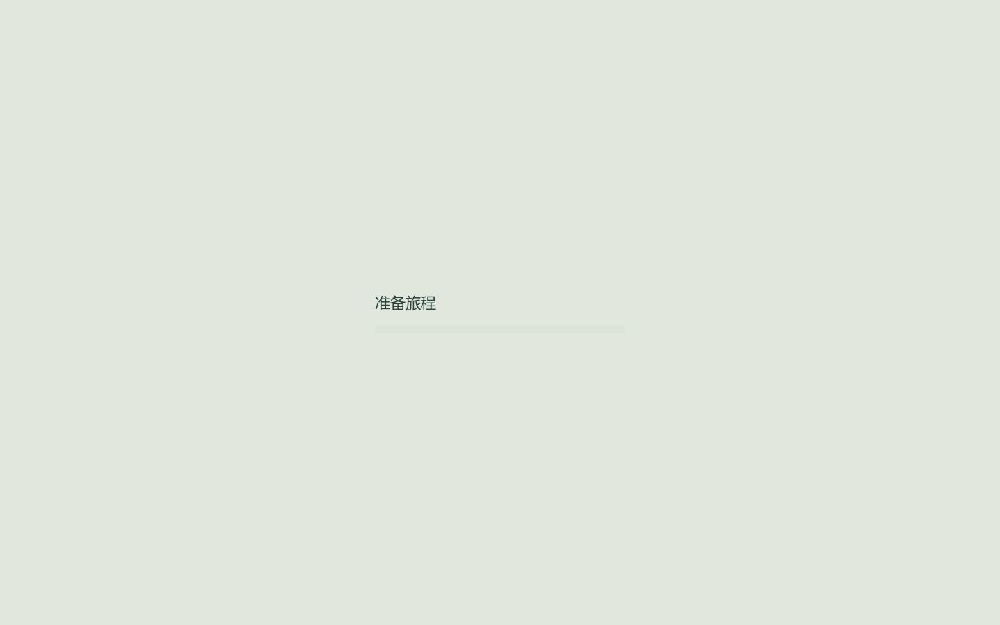
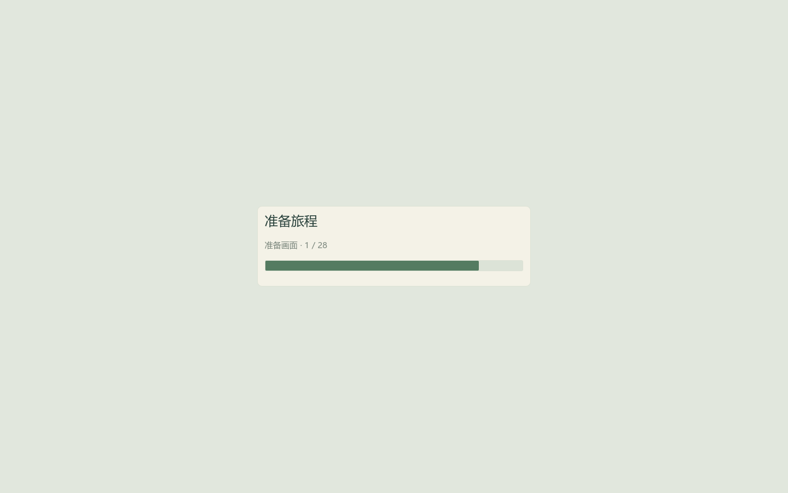

# QA-04：轻量启动与画面预热

Windows 试玩版 **0.4.0**。先显示轻量等待页，后台读取原生导入资源，再在主线程初始化游戏脚本。新玩家选规模前不再生成一张随后丢弃的 3D 地图，选择界面使用纯色背景。保存格式、修行与石料规则、飞行和射程均沿用原实现。



选择规模后构建真正的世界；进入操作前，以独立的 128×128 视口分批绘制代表性画面。覆盖普通网格、带颜色/自定义数据的 MultiMesh、保留骨骼绑定的精卫与穿山甲、飞石、碎屑、神器、新陆地与海岸泡沫。用渲染器实际绘制次数验证每组参与绘制，随后销毁临时视口。画面样本不碰资源账本，也不调用真实投石、发现神器或开采入口。



同一进程按画质、渲染方式和角色/山体场景区分完成集合；换图可以复用，第一次切换画质则在暂停的设置界面后准备对应画面。跨进程不保存“已经准备”的自定义布尔值，每次仍实际绘制一次，复用由引擎的设备相关着色器缓存负责。引擎缓存留在用户目录，不随 ZIP 分发，不清理用户或系统的显卡缓存。

Compatibility 的首次绘制仍可能触发同步编译，预热把部分等待移到进入操作前，不能让所有首次编译消失。此实现依据 Godot 的 [Compatibility 预热说明](https://docs.godotengine.org/en/4.5/tutorials/rendering/jitter_stutter.html#stutter)；[管线预编译说明](https://docs.godotengine.org/en/4.6/tutorials/performance/pipeline_compilations.html)中的现代图形 API 方案不适用于当前 OpenGL 路径。

## 验证结果与代价

源码全套合计 **1,812 项**通过。新增真实默认启动入口检查，确认选择前不写占位旅程、不建世界、不推进模拟；图形检查确认 **28/28 组**实际绘制、效果池事件与账本保持不变、画质切换后返回设置、再次换图复用进程内准备集合，释放后无孤儿节点。新增原生资源包清单核查，确保它覆盖当前 **68 个**正式模型、材质、声音和神器图标引用；没有将游戏脚本交给后台资源包初始化。

曾尝试后台读取整个游戏场景，在本机首轮退出检查中出现 20 个临时 RefCounted 对象残留警告。最终只后台读取原生资源包，再在主线程解析脚本并实例化场景；后续首轮/次轮检查没有该警告。工具将对象残留/孤儿警告与脚本错误一起视为失败，不以“测试结果 0 失败”掩盖退出诊断。

独立包验收还捕获了准备期关闭时未收回资源请求的残留警告，已补齐请求的等待/收回与关闭标记。正常切场景、窗口关闭和树退出都处理请求生命周期；关闭标记阻止随后回调继续创建游戏场景。图形与无窗口关闭检查均未生成占位旅程，退出无残留警告。

性能对比使用显式编辑器检查程序，分别挂载 **QA-03 正式 PCK** 与 **QA-04 导出候选 PCK**，从项目真实默认入口加载，检查程序没有提前 preload Main/World。i9-13900HX / RTX 4060 Laptop / NVIDIA 581.57，1440×900 Compatibility。先用新的应用用户目录，再使用同一目录启动第二个全新进程。两次进程之间保留引擎缓存；未清空系统显卡驱动缓存，因此首轮不是受控的完整冷启动基准。

| 首轮指标 | QA-03 | QA-04 |
| --- | ---: | ---: |
| 首个等待帧提交 | 357.90ms | 80.38ms |
| 可选择规模的画面 | 6127.98ms | 342.00ms |
| 选择后首次地图完整准备 | 155.53ms | **7716.66ms** |
| 首次效果：最长帧 | 685.51ms | 5.63ms |
| 首次新陆地：最长帧 | 838.80ms | 6.57ms |
| 再次换图：总时长 | 155.42ms | 172.18ms |

**没有声称首次游玩总等待更短。** 旧版在显示规模选择前已经花时间生成临时海岸；本版先让用户选择，并把额外的稀有画面准备前置。首轮选择后的地图准备仍需约 **7.72 秒**，其中最长帧 **1.71 秒**，第一次切流畅画质也需约 **1.33 秒**、最长帧 **523ms**。这些停顿留在报告中，不能只引用操作后的 6ms。

同目录第二个新进程中，续档与实际画面准备合计约 **1.01 秒**；首次效果/新陆地最长帧为 **5.57/6.34ms**。两轮分别确认 28/28 组参与绘制，第二进程没有使用上一个进程的内存标记。引擎缓存文件在首轮由 0 增至 22，次轮开始及结束均为 22；文件数量不是着色器变体数量，也不能单凭数量证明命中，耗时变化及真实绘制证据一起保留。具体见 [逐项表](validation/qa04/table.md) 与 [摘要](validation/qa04/summary.json)。

时间从检查程序开始加载默认入口起计，包含资源读取、脚本初始化与对应的绘制等待；不包括操作系统启动 EXE 和引擎在检查程序之前的初始化。独立逐帧节点持续采样，阶段结束后继续两帧以覆盖最后的绘制；不是 GPU 呈现延迟或普通玩家帧率。审阅截图另开进程，未把图片读回/写入混入性能计时。满海域是显式补记生成石料的守恒夹具，不是手工通关。

四档地图 × 两档画质的短生命周期回归 **374 项**通过，保留保存、坏主文件恢复、重开和旧世界/效果池释放检查；每场参数仅 3 秒，不替代 QA-02 的 12 分钟持续运行报告。最终 ZIP 另验证打包依赖、默认启动、准备期关闭、旧档、设置及真正 release EXE 的四档捕获。检查程序与截图、存档、设备缓存均在包外。

## 复现与维护

```powershell
.\Test.cmd
.\tools\measure-startup.ps1 -Output artifacts/qa04-before -PackPath builds/Jingwei-QA-03-Windows-x64-final/Jingwei.pck -Baseline
.\tools\measure-startup.ps1 -Output artifacts/qa04-after -PackPath builds/Jingwei-QA-04-Windows-x64-final/Jingwei.pck
.\tools\build-windows.ps1 -Destination builds/Jingwei-QA-04-Windows-x64-final
.\tools\verify-windows.ps1 -ZipPath builds/Jingwei-QA-04-Windows-x64-final.zip -Destination 'artifacts/QA-04 最终交付验证'
```

输出使用全新的 artifacts/builds 子目录。源码资源清单增加正式模型、材质、音效或神器图标时，应同步更新 `assets/startup_bundle.tres`；发行资产检查会比对清单，避免新增资源退回启动时同步读取。预热按当前正式渲染特征取代表，不保证任意自定义材质、视角或其他 GPU 都没有新编译。

普通同步自动保存仍在 QA-05 处理。未改变玩家偏好与旅程的位置，也未为项目选定授权、签名或发布商店；其他硬件及最低配置仍未验收。
