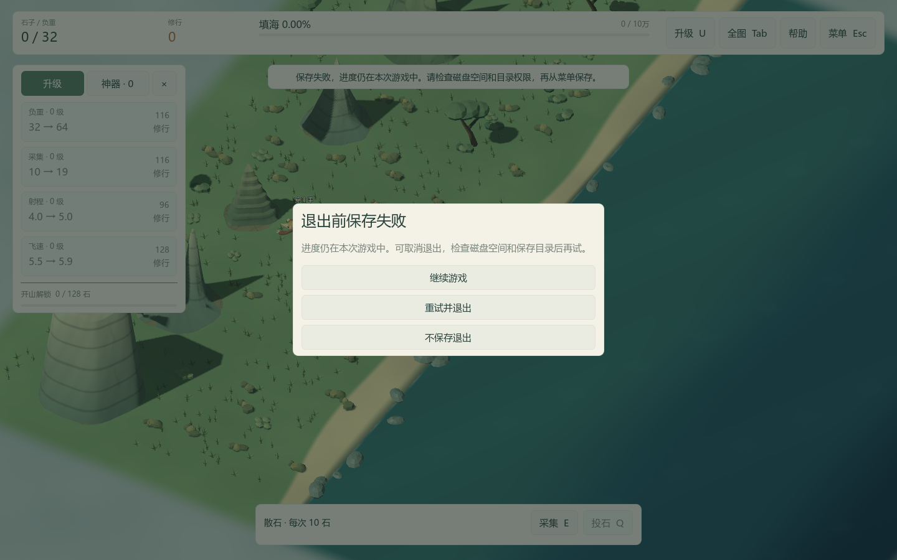

# QA-05：后台自动保存与失败恢复

2026-10-16，版本 0.5.3。

## 玩家可见变化

每 15 秒游戏时间，以及解锁采矿、完成填海时，自动保存改为后台写入。暂停菜单显示正在保存、已保存或保存失败；成功的例行自动保存不弹通知。连续请求合并，上一笔完成后保存最新进度。

写盘失败会提示检查磁盘空间和目录权限，游戏内进度继续保留；之后的自动保存会重试，也可从菜单手动保存。重复失败不会每次弹通知，恢复成功会提示。退出前保存失败时不会直接关闭，提供继续游戏、重试并退出、不保存退出三个选择。

## 保存边界

- 主线程复制独立快照，后台完成校验、JSON 编码和文件操作。始终只有一个自动保存线程；后续请求只记录待保存标记，不堆积快照。
- 主存档写入临时文件后替换；上一代有效存档的备份也先写 `.bak.tmp` 再替换 `.bak`，避免备份写到一半破坏旧备份。损坏主档仍从有效备份恢复，修复主档时保留有效备份。旅程格式继续为 v3，兼容原 v2 迁移。
- 换图先等待正在写入的旧旅程，再归档和创建新旅程，避免旧线程覆盖新存档。关闭节点时回收线程。
- 手动保存和正常退出仍等待写盘完成，确保“已保存”代表写入成功；慢磁盘下这两个明确操作仍可能等待。新图和归档沿用带等待画面的后台加载流程。自动保存快照复制仍在主线程，本包不声称所有存档工作都无停顿。

## 验证范围

新增 34 项检查，覆盖四档规模的快照隔离、后台写入、连续请求合并、手动保存与后台写入顺序、临时写入失败、备份暂存失败、原档字节保持、自动恢复、损坏主档回退、退出失败选择及旧线程与换图衔接。以隔离目录模拟不可写目标，不修改玩家目录权限或存档。原有 2,056 项与新增检查合计 2,090 项通过（修正样板场景接口和完成保存的异步等待后分组补测），独立包另行复查旧档迁移、加载、第一人称和样板场景相关资源。

真实 OpenGL 窗口完成 34 项检查并记录截图。测试夹具在工作线程注入 300 ms 等待，其间观察到主循环继续运行；此延迟只在测试子类中，发行版不包含。报告见 [原始记录](validation/qa05/autosave.json)。

该次四档自动保存请求的主线程耗时约 0.10 / 0.14 / 0.30 / 0.53 ms，同一实现的同步参考写入约 2.20 / 6.13 / 30.57 / 146.68 ms。每档仅一次，同机另有回归测试运行，路径与是否已有备份也影响写盘耗时；这些数据只说明主线程工作已转移，不是旧版本对比、帧率百分位、长期压力结果或最低配置承诺。没有模拟断电或真实磁盘写满，临时文件替换也不等同于断电绝对安全。

复现入口：Test.cmd；图形验收可运行 tests/test_autosave.gd 并传 `--autosave-out` 指定全新隔离目录。Windows 构建版本为 QA-05 / 0.5.3，验收工具对实际导出 PCK 运行新增检查，并启动发行 EXE 检查四档地图、选择界面和旧档续玩。构建与验收目录记录源提交、文件哈希和检查结果。
